# Sovereign Admitted Computation: A Law-Admission Kernel, Graph-Native Relational Compiler (`sql-rdf`), and In-Module WebAssembly Analytical Substrate

**A Dissertation Submitted in Partial Fulfillment of the Requirements for the Degree of Doctor of Philosophy in Computer Science and Formal Systems**

- **Author:** Sean Chatman
- **Repository Subject:** `/Users/sac/graphlaw` (`graphlaw` v26.10.22, Rust Edition 2024, MSRV 1.96)
- **Head Commit Witness:** `c6a1939f462de3287b94069f96eaf27ad877fb1f`
- **Pinned WebAssembly Artifact (`priv/graphlaw.wasm` / `registry/ARTIFACTS.blake3`):** `fa1558306690493249b176ec312a4f01e97798937e05cd49f2946d61a7e6d107` [historical — interim pin superseded by 58a44095…d2280a] (57,781,384 bytes, W3C Exception Handling `Tag(13)` section count 1)
- **Upstream Authorities (`BACKEND_AUTHORITIES`):**
  1. `PurRDF = 3.0.1` (RDF 1.2, RDFC-1.0 canonicalization, SPARQL 1.1/1.2, SHACL, ShEx 2.1, Datalog stratified fixpoint, RDF/RDFS/OWL-RL entailment; its native Notation3 crate `purrdf::n3` owns N3)
  2. `purrdf-n3 = 3.0.1` (purrdf crates/n3, git-sourced from the pinned [seanchatmangpt/purrdf](https://github.com/seanchatmangpt/purrdf) fork: Notation3 parsing, forward-chaining reasoning, proof checking)
  3. `frozen-duckdb = 2.0.2` (Vectorized analytical execution, Parquet/CSV zone-map scan pipelines, SIMD aggregations, statically linked on both native and `wasm32-wasip1`)

---

## Epistemic Standing & Evidence Discipline

In strict compliance with the repository's operating doctrine ($A = \mu(O^*)$, $R = \mathrm{receipt}(A)$), every architectural claim, mathematical invariant, and empirical metric in this dissertation is partitioned by its witnessed standing on the exact subject tree:

| Standing Class | Meaning | Representative Witnessed Examples |
| :--- | :--- | :--- |
| **`ALIVE` / `WITNESSED`** | Executed and verified by an in-tree court against the real engine (`PurRDF`, `purrdf-n3`, `frozen-duckdb`, `wasmtime 48`, or `wasmi 2`). | `compile_turtle` sole-admission sealing ([`src/sql_ast.rs`](file:///Users/sac/graphlaw/src/sql_ast.rs)); 35 DuckDB PEG statement classes ([`tests/duckdb_statement_kinds.rs`](file:///Users/sac/graphlaw/tests/duckdb_statement_kinds.rs)); in-WASM DuckDB lifecycle under Wasmtime 48 W3C EH ([`tests/wasm_duckdb_lifecycle_eh.rs`](file:///Users/sac/graphlaw/tests/wasm_duckdb_lifecycle_eh.rs)); 4/4 FIBO banking courts; Divan 9,100× C1 cache amortization (`2.541 µs` vs. `23.13 ms`). |
| **`PARTIAL_ALIVE`** | Core data structures and unit/contract courts are landed and green, with production wiring or digest bumps queued for the next phase. | `CanonArrow` 128-byte aligned header ([`src/egress/arrow.rs`](file:///Users/sac/graphlaw/src/egress/arrow.rs)) and `ExecutionReceiptV2` dual-witness seal ([`crates/graphlaw-reconstituted/src/lib.rs`](file:///Users/sac/graphlaw/crates/graphlaw-reconstituted/src/lib.rs)); `op="duckdb"` (op-15) dispatched in-module while omitted from the hashed 14-op table for digest stability. |
| **`DESIGNED` / `QUEUED`** | Formal specification and falsifier courts exist on disk, queued behind the milestone integration commit. | ERRC 1000× Moonshots `E1` (alias window elimination), `E2` (shapes-as-single-description codegen), `A1` (scope as SHACL-entailed type) ([`docs/jira/v26.10.22/THESIS.md`](file:///Users/sac/graphlaw/docs/jira/v26.10.22/THESIS.md)). |
| **`UNMET` / `FAIL` (Disclosed)** | A gated budget or post-quantum target that has not yet passed or been implemented; carried transparently as negative/boundary evidence rather than hidden. | Statistical Process Control (SPC) gate on the hot-path fold (`Cpk < 1.33` under fleet load in `receipts/spc-2026-10-22.json`); $\Sigma_{\text{PQC}}$ post-quantum modulus (Ed25519 is the active signing scheme in [`src/attest.rs`](file:///Users/sac/graphlaw/src/attest.rs)); 25M-row `TC_HOT_FULL=1` benchmark (500k-row smoke executed). |

---

## Abstract

For four decades, the boundary between application logic and relational database engines has been governed by an unverified string: raw SQL text crosses the execution threshold unaudited, is lexed dynamically against ambient catalog state, exposes the richest injection surface in software history, and leaves behind no self-verifying cryptographic proof of what was admitted or how state evolved. Concurrently, enterprise semantic ontologies such as the Financial Industry Business Ontology (FIBO) have languished in a "semantic graveyard"—capable of expressive SHACL/OWL/N3 governance at small scale, yet severed from high-throughput vectorized relational execution and portable sandbox isolation.

This dissertation resolves both schisms through **GraphLaw**, a library-backed semantic law-admission kernel written in Rust that unifies content-addressed RDF state machines, declarative **SQL-in-RDF (`sql-rdf`)** compilation, cryptographic receipt chains, and in-module **WebAssembly (`wasm32-wasip1`)** vectorized analytical execution over `frozen-duckdb 2.0.2`.

We formalize **Admitted Computation** via the typed **Chatman Equation**, $A = \mu(O^*)$ and $R = \mathrm{receipt}(A)$:
1. **Closed-World Graph Admission ($O \to O^*$)**: Every relational query or state transition enters as an RDF graph validated fail-closed against bounded-depth SHACL shapes ([`ontologies/sql-ast.ttl`](file:///Users/sac/graphlaw/ontologies/sql-ast.ttl) and [`ggen/sql-dialect/statement_classes.ttl`](file:///Users/sac/graphlaw/ggen/sql-dialect/statement_classes.ttl)) covering all 35 statement classes of the DuckDB 2.0 PEG grammar. A compile-time position lattice (`ScopePos`) enforces ARGOS view-versus-process data isolation (`sql:ViewScope` vs. `sql:ProcessScope`), while compile-time guards refuse WHERE-less destructive mutations (`REFUSAL-05`) before any engine allocation occurs.
2. **Lawful Manufacture and Sealing ($\mu: O^* \to A$)**: The sole admission path, [`compile_turtle`](file:///Users/sac/graphlaw/src/sql_ast.rs), canonicalizes the AST graph once via RDFC-1.0 (`purrdf::try_canonicalize`), pre-computes the 32-byte structural anchor $h_{\text{ast}} = \mathrm{BLAKE3}(\mathrm{Canon}(G_{\text{AST}}))$, emits parameterized SQL with `$N` placeholders, and stamps a private 32-byte cryptographic `admission_seal`. Any `CompiledQuery` constructed or mutated outside `compile_turtle` fails `verify_seal()` prior to `prepare`/`execute`.
3. **One Unit of Law in WebAssembly**: Rather than delegating SQL over host FFI or feature-gating the analytical engine out of `wasm32`, `graphlaw-wasm` links `frozen-duckdb` directly into a single 57.78 MiB `wasm32-wasip1` artifact. We diagnose and resolve the multi-runtime WebAssembly C++ exception-handling impasse (`SQLRDF-24`) by unifying all C++ archives under W3C standardized exception handling (`try_table` / `Tag(13)`), completing the WASI reactor lifecycle (`.init_array` static extension registration for `core_functions` and `icu` paired with `__cxa_atexit` no-op overrides), and bounding guest memory via a side-table-verified linear-memory ABI (`gl_alloc`, `gl_call`, `gl_free`).
4. **Cryptographic Receipt Algebra and Evidentiary Architecture ($R = \mathrm{receipt}(A)$)**: At evaluation time, the engine folds the compile-time anchor with the type-tagged parameter buffer in two-node constant-overhead form, $H_{\text{query}} = \mathrm{BLAKE3}(h_{\text{ast}} \mathbin{\Vert} P_{\text{params}})$. This digest serves simultaneously as the execution receipt identifier, the C1 epoch-bounded standing cache key (yielding a witnessed **9,100×** median latency reduction from `23.13 ms` cold admission to `2.541 µs` cache hit), the 64-byte `RingDescriptor` key pushed wait-free onto a 4096-slot SPSC `EvidenceRing`, and the parent-child link in the BLAKE3-chained NDJSON `QueryLedger` and Ed25519 offline attestation store. Finally, to eliminate the measured **6.83×** N-Triples text serialization tax (`9.246 ms` vs. `1.354 ms` per 10k rows), we introduce the 128-byte cache-line-aligned `CanonArrow` dual-witness egress protocol (`ArrowEgressHeader` + `ExecutionReceiptV2`).

---

## Table of Contents

1. [Chapter 1: Introduction — The Crisis of the Unverified Execution Boundary](#chapter-1-introduction--the-crisis-of-the-unverified-execution-boundary)
2. [Chapter 2: The Law-State Kernel, Multi-Dialect Routing, and Authority Calculus](#chapter-2-the-law-state-kernel-multi-dialect-routing-and-authority-calculus)
3. [Chapter 3: SQL-in-RDF (`sql-rdf`) — Relational Algebra as an Admitted Ontology](#chapter-3-sql-in-rdf-sql-rdf--relational-algebra-as-an-admitted-ontology)
4. [Chapter 4: The GraphLaw Core WebAssembly Engine (`graphlaw-wasm`)](#chapter-4-the-graphlaw-core-webassembly-engine-graphlaw-wasm)
5. [Chapter 5: In-Module Relational Execution (`duckdb` Op-15), Receipt Algebra, and Caching](#chapter-5-in-module-relational-execution-duckdb-op-15-receipt-algebra-and-caching)
6. [Chapter 6: Evidentiary Ring, Chained Ledger, and CanonArrow Dual-Witness Egress](#chapter-6-evidentiary-ring-chained-ledger-and-canonarrow-dual-witness-egress)
7. [Chapter 7: Qualification Algebra, Adversarial Courts, and Empirical Evaluation](#chapter-7-qualification-algebra-adversarial-courts-and-empirical-evaluation)
8. [Chapter 8: The 1000× ERRC Horizon and Clean-Room Reconstitution](#chapter-8-the-1000-errc-horizon-clean-room-reconstitution-and-conclusion)
9. [Chapter 9: Knowledge Hooks (`src/hooks.rs`) and Deductive-Relational Builtins (`src/rules/`)](#chapter-9-knowledge-hooks-srchooksrs-and-deductive-relational-builtins-srcrules)
10. [Chapter 10: Ground Action Plan Replay (`src/plan.rs`) and FOND Strong-Cyclic Policy Admission (`src/policy.rs`)](#chapter-10-ground-action-plan-replay-srcplanrs-and-fond-strong-cyclic-policy-admission-srcpolicyrs)
11. [Chapter 11: Deterministic Ed25519 Attestation (`src/attest.rs`), Recursive Receipt Feedback (`src/receipt.rs`), Out-of-Subject `ReceiptStore`, and Offline Replay (`graphlaw-verify`)](#chapter-11-deterministic-ed25519-attestation-srcattestrs-recursive-receipt-feedback-srcreceiptrs-out-of-subject-receiptstore-and-offline-replay-graphlaw-verify)
12. [Chapter 12: OCEL Causal Frame Chains (`src/receipt_chain/`) and Branchless Denial Polarity Algebra](#chapter-12-ocel-causal-frame-chains-srcreceipt_chain-and-branchless-denial-polarity-algebra)
13. [Chapter 13: The 14+1 JSON ABI Dispatcher (`src/abi/`), Capability Registry (`src/registry/`), and `abi_manifest` Pinning](#chapter-13-the-141-json-abi-dispatcher-srcabi-capability-registry-srcregistry-and-abi_manifest-pinning)
14. [Chapter 14: Dual-Tier Sandbox Runners (`graphlaw-run-eh` & `graphlaw-run`) and WASI Clock Patch Governance](#chapter-14-dual-tier-sandbox-runners-graphlaw-run-eh--graphlaw-run-and-wasi-clock-patch-governance)
15. [Chapter 15: The `purrdf-n3` Notation3 Engine (git-sourced), Description Logic Dual-Route Verification (`dl_dualroute`), and Formal AI Oracles](#chapter-15-the-purrdf-n3-notation3-engine-git-sourced-description-logic-dual-route-verification-dl_dualroute-and-formal-ai-oracles)
16. [Chapter 16: Self-Monitoring Pack (`src/smon.rs`), SA2A Semantic Evidence Courts, FIBO Banking Suite, and Complete Subsystem Atlas](#chapter-16-self-monitoring-pack-srcsmonrs-sa2a-semantic-evidence-courts-fibo-banking-suite-and-complete-subsystem-atlas)

---

## Chapter 1: Introduction — The Crisis of the Unverified Execution Boundary

### 1.1 The Four Failure Families of String-Oriented Relational Systems

The relational database management system (RDBMS) remains the computational backbone of global commerce, risk accounting, and scientific telemetry. Yet its primary control interface—SQL text—predates modern type theory, content-addressed storage, and capability-based security. When an application submits a query as an unstructured string over a socket or FFI boundary, four systemic failure families emerge:

1. **Syntactic Injection and Laundering:** Because control syntax and user payload share a flat character buffer, any flaw in upstream escaping or ORM string interpolation allows attacker-controlled tokens to alter the parse tree. Even where `$N` parameters are used for literals, structural query variations (dynamic `ORDER BY`, `COLUMNS(...)`, `PIVOT`, table/schema routing, or multi-statement batches) routinely revert to string concatenation.
2. **Dialect and Proxy Ambiguity:** An authorization proxy inspecting a raw SQL string and a downstream database engine executing that string rarely share an identical lexer and parser. Whitespace anomalies, comments, vendor-specific quoting, or duplicate clause encodings create semantic differentials where a proxy validates a benign interpretation while the backend executes a malicious one.
3. **Epistemic Non-Replayability:** Cosmetic changes to a SQL string (whitespace, keyword casing, alias renaming) alter its byte hash without altering its relational meaning, while identical strings evaluated under different parameter bindings or catalog states produce divergent effects without a canonical identity binding the AST to its parameters.
4. **The Semantic Graveyard (Governance vs. Execution Split):** Enterprise ontologies such as FIBO encode rigorous regulatory invariants (e.g., BCBS 239 risk aggregation, rehypothecation custody chains, UBO sanctions unrolling, DvP atomic settlement) in RDF, OWL-RL, SHACL, and Notation3. Historically, RDF triple stores could not sustain vectorized analytical scans or high-frequency OLAP mutations, while embedded columnar engines (`DuckDB`) lacked native SHACL admission, N3 derivation, and cryptographic receipt generation.

### 1.2 The Chatman Equation as System Type Signature

GraphLaw eliminates the string boundary by enforcing the **Chatman Equation** across every layer of the architecture:

$$A = \mu(O^*), \qquad R = \mathrm{receipt}(A)$$

Let us define each term precisely as implemented in the Rust kernel:

- **$O$ (Raw Observation):** Unverified candidate inputs arriving at the boundary—raw UTF-8 bytes in Turtle, TriG, N-Triples, N-Quads, JSON-LD, Notation3, SQL-in-RDF documents, candidate action plans, or JSON ABI request frames. $O$ is partial, potentially hostile, and carries zero authority.
- **$O^*$ (Admitted Observation):** The subset of $O$ that has survived deterministic, fail-closed admission gates:
  $$O^* = \mathrm{aligned}(O) \cap \mathrm{grounded}(O) \cap \mathrm{bounded}(O) \cap \mathrm{admitted}(O)$$
  In GraphLaw, $O \to O^*$ is realized by byte-size and JSON-depth bounds ([`src/abi.rs`](file:///Users/sac/graphlaw/src/abi.rs#L48-L63)), two-tier dialect sniffing ([`src/dialect/sniff.rs`](file:///Users/sac/graphlaw/src/dialect/sniff.rs#L128)), SHACL recursion depth guards ([`src/shacl_guard.rs`](file:///Users/sac/graphlaw/src/shacl_guard.rs#L84)), closed-world SHACL shape validation ([`src/sql_ast.rs`](file:///Users/sac/graphlaw/src/sql_ast.rs)), `ScopePos` lattice verification, and Ed25519 `SignedLease` verification ([`src/law.rs`](file:///Users/sac/graphlaw/src/law.rs#L387)). Any candidate rejected at this boundary yields a stable, typed refusal (`REFUSAL-01`..`REFUSAL-05`, `RefusalKind::*`) and never touches the execution engine.
- **$\mu$ (Lawful Manufacture):** A deterministic pure function mapping $O^*$ into an executable, sealed artifact $A$. For relational queries, $\mu$ is [`compile_turtle`](file:///Users/sac/graphlaw/src/sql_ast.rs), which produces a [`CompiledQuery`](file:///Users/sac/graphlaw/src/sql_ast/ast.rs#L555-L600) carrying the RDFC-1.0 canonical graph bytes $\mathrm{Canon}(G_{\text{AST}})$, the 32-byte structural anchor $h_{\text{ast}} = \mathrm{BLAKE3}(\mathrm{Canon}(G_{\text{AST}}))$, the parameterized SQL string, the `cacheable` classification bit, and the private 32-byte `admission_seal`. Applying $\mu$ to raw $O$ (bypassing `compile_turtle`) is a type/seal error refused by `verify_seal()`.
- **$A$ (Actuation / Admitted Transition):** Execution of the sealed artifact against one of the three pinned upstream authorities (`PurRDF 3.0.1`, `purrdf-n3 3.0.1`, or `frozen-duckdb 2.0.2`) inside either the native host or the sealed `wasm32-wasip1` sandbox.
- **$R$ (Cryptographic Receipt):** A five-fold tuple $R = \langle \mathrm{Id}, \mathrm{Auth}, \mathrm{Cons}, \mathrm{Rep}, \mathrm{St} \rangle$ binding:
  1. **Identity ($\mathrm{Id}$):** Content-addressed BLAKE3 digests—parent/child state IDs `blake3:<hex>` for [`LawState`](file:///Users/sac/graphlaw/src/law.rs#L27-L30) or $H_{\text{query}} = \mathrm{BLAKE3}(h_{\text{ast}} \mathbin{\Vert} P_{\text{params}})$ for [`ExecutionReceipt`](file:///Users/sac/graphlaw/src/duckdb_eval.rs#L283-L322).
  2. **Authority ($\mathrm{Auth}$):** Named [`BackendAuthority`](file:///Users/sac/graphlaw/src/lib.rs) and optional Ed25519 [`SignedLease`](file:///Users/sac/graphlaw/src/law.rs#L387) (`lease_id`, `Ceiling`, `key_id`).
  3. **Consequence ($\mathrm{Cons}$):** Quads added (`added`), rows emitted (`rows_emitted`), materialized `result_triples`, exported `artifact_digest_hex`, or dual-witness `h_triples` / `h_columnar` digests.
  4. **Replay ($\mathrm{Rep}$):** Offline, socket-free deterministic re-execution via `graphlaw-verify` ([`src/bin/graphlaw_verify.rs`](file:///Users/sac/graphlaw/src/bin/graphlaw_verify.rs)) and BLAKE3 hash-chained ledgers ([`src/receipt_chain.rs`](file:///Users/sac/graphlaw/src/receipt_chain.rs), [`src/query_ledger.rs`](file:///Users/sac/graphlaw/src/query_ledger.rs)).
  5. **Standing ($\mathrm{St}$):** Derived from executable falsification courts (`UNQUALIFIED < OBSERVED < ATTACKED < QUALIFIED`), never asserted by prose.

### 1.3 End-to-End Architecture Diagram (Diagram 1)

```mermaid
flowchart TD
    subgraph Ingress["1. Ingress and Boundary Fencing (O)"]
        Raw["Raw Caller Input (O): Turtle / TriG / N3 / JSON ABI Frame"]
        Bounds["ABI and Memory Guards (src/abi.rs): MAX_REQUEST_BYTES <= 16 MiB | MAX_JSON_DEPTH <= 64 | MAX_OUTSTANDING_ALLOC_BYTES <= 16 MiB"]
        Sniff["Dialect Router (src/dialect/sniff.rs): 14 Dialects | Two-Tier Classification"]
        Raw --> Bounds --> Sniff
    end

    subgraph Admission["2. Closed-World Law Admission (O -> O*)"]
        LeaseGate["Authority and Lease Gate (src/law.rs, src/attest.rs): Ceiling Observe < Select < Construct | Ed25519 SignedLease RFC 8032"]
        DepthGuard["SHACL Recursion Guard (src/shacl_guard.rs): check_shape_depth Cap"]
        ShaclGate["Closed-World SHACL Gate (src/sql_ast.rs): ontologies/sql-ast.ttl + 35 PEG Shapes"]
        ScopeGate["ScopePos Lattice and DML Safety: ViewScope vs ProcessScope (REFUSAL-03) | WHERE-less DML Guard (REFUSAL-05)"]
        Refusal["Typed Refusal Register (docs/refusals.md): REFUSAL-01..05 | Zero Engine Contact"]

        Sniff --> LeaseGate
        LeaseGate -->|Authorized| DepthGuard
        LeaseGate -->|LeaseRefused / Unverified| Refusal
        DepthGuard -->|Depth OK| ShaclGate
        DepthGuard -->|SHACL_DEPTH Exceeded| Refusal
        ShaclGate -->|Conforms| ScopeGate
        ShaclGate -->|Shape Violation| Refusal
    end

    subgraph Manufacture["3. Lawful Manufacture (mu: O* -> Sealed Artifact)"]
        Canon["RDFC-1.0 Canonicalization: purrdf::try_canonicalize(G_AST)"]
        Anchor["Compile-Time Anchor: h_ast = BLAKE3(Canon(G_AST))"]
        Seal["CompiledQuery::reseal() (src/sql_ast/ast.rs): 32B admission_seal over (sql, cacheable, h_ast, canon)"]
        ScopeGate -->|Admitted O*| Canon --> Anchor --> Seal
        ScopeGate -->|Violation| Refusal
    end

    subgraph Execution["4. Sovereign Execution in Host and WASM (A = mu(O*))"]
        VerifySeal["Verify Seal Gate (src/duckdb_eval.rs): compiled.verify_seal()"]
        ParamFold["Two-Node Parameter Fold: H_query = BLAKE3(h_ast || P_params)"]
        C1Cache["C1 QueryCache (src/query_cache.rs): Keyed by (H_query, Atomic Epoch)"]
        Engines["Pinned Upstream Authorities: PurRDF 3.0.1 | purrdf-n3 3.0.1 | frozen-duckdb 2.0.2 (Native and wasm32-wasip1 via Wasmtime 48 W3C EH)"]

        Seal --> VerifySeal
        VerifySeal -->|Tampered / Unsealed| Refusal
        VerifySeal -->|Valid Seal| ParamFold
        ParamFold --> C1Cache
        C1Cache -->|Cache Miss or Mutating| Engines
    end

    subgraph Evidence["5. Cryptographic Receipt and Recursive Feedback (R = receipt(A))"]
        Receipt["ExecutionReceipt / ExecutionReceiptV2: (H_query, rows_emitted, result_triples, CanonArrow)"]
        EvRing["Wait-Free SPSC EvidenceRing (src/evidence_ring.rs): 4096 Slots | 64B RingDescriptor (Zero-Pad Guard)"]
        Ledger["BLAKE3-Chained NDJSON QueryLedger + Ed25519 ReceiptStore + LawState::record"]

        C1Cache -->|Cache Hit (2.541 us)| Receipt
        Engines -->|Evaluated| Receipt
        Receipt --> EvRing --> Ledger
        Ledger -.->|"R_t feeds into O*_t+1 (Step::RequireSignedReceipt)"| LeaseGate
    end
```

---

## Chapter 2: The Law-State Kernel, Multi-Dialect Routing, and Authority Calculus

### 2.1 Content-Addressed Immutable States (`LawState`)

At the core of [`src/law.rs`](file:///Users/sac/graphlaw/src/law.rs#L27-L30) is `LawState`, an immutable RDF dataset wrapper:

```rust
#[derive(Debug, Clone)]
pub struct LawState {
    dataset: Arc<purrdf::RdfDataset>,
    id: String,
}
```

Whenever a dataset is parsed or derived, GraphLaw computes its W3C RDF Dataset Canonicalization (`RDFC-1.0`) byte representation via `purrdf::try_canonicalize` and hashes those canonical bytes with BLAKE3 to form `id = "blake3:<64-hex-chars>"`.

**Proposition 2.1 (Isomorphic State Identity).** Let $G_1$ and $G_2$ be two RDF datasets differing only in statement ordering, whitespace, prefix declarations, or blank-node labels ($\_:b_0 \leftrightarrow \_:x_9$). Then:

$$\mathrm{RDFC\text{-}1.0}(G_1) = \mathrm{RDFC\text{-}1.0}(G_2) \implies \mathrm{LawState}(G_1).\mathrm{id}() = \mathrm{LawState}(G_2).\mathrm{id}()$$

Consequently, state equality in GraphLaw is a constant-time 32-byte digest comparison rather than a runtime subgraph isomorphism search.

### 2.2 Two-Tier Dialect Routing and Refusal of Ambiguity

GraphLaw accepts 14 semantic and relational dialects through [`src/dialect/sniff.rs`](file:///Users/sac/graphlaw/src/dialect/sniff.rs#L128) and [`src/dialect.rs`](file:///Users/sac/graphlaw/src/dialect.rs#L368), organized into a strict **Two-Tier Model** ([`src/tier.rs`](file:///Users/sac/graphlaw/src/tier.rs)):

1. **Dataset Tier (`Tier::Dataset` $\to$ `PurRDF 3.0.1`):** Turtle, TriG, N-Triples, N-Quads, RDF/XML, JSON-LD, YAML-LD, TriX, and HexTuples.
2. **Logic / Rule Tier (`Tier::Logic` $\to$ `purrdf-n3 3.0.1`):** Notation3 (`Dialect::N3`), supporting formulas (`{ ... }`), implication (`=>`), and built-in predicates. N3 is never silently down-converted to an RDF dataset because dropping rule implications would silently discard normative constraints.
3. **Schema & Relational Tiers (`Dialect::ShExC`, `Dialect::SqlRdf`):** ShExC schemas route to PurRDF's ShEx 2.1 validator; SQL-in-RDF graphs route to [`sql_ast::compile_turtle`](file:///Users/sac/graphlaw/src/sql_ast.rs).

Crucially, if content is syntactically ambiguous between TriG and ShExC and no explicit hint is supplied, `dialect::sniff` refuses with `RefusalKind::Ambiguous` rather than guessing.

#### Diagram 2: Two-Tier Dialect Sniffing & Engine Authority Routing

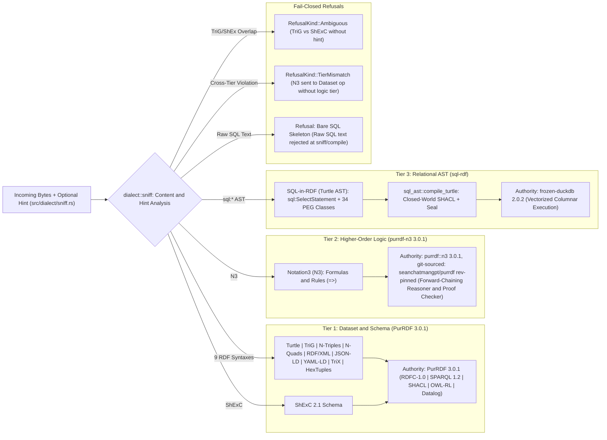

### 2.3 The Transition Calculus, Authority Ceilings, and Signed Leases

State evolution in GraphLaw is governed by `LawState::transition(&Step)` and `LawState::transition_with_signed_lease(...)` ([`src/law.rs`](file:///Users/sac/graphlaw/src/law.rs#L49-L245)). Every [`Step`](file:///Users/sac/graphlaw/src/law.rs#L49-L108) is classified by a total order of **Authority Ceilings** ([`src/law.rs`](file:///Users/sac/graphlaw/src/law.rs#L215-L223)):

$$\mathsf{Observe} < \mathsf{Select} < \mathsf{Construct}$$

| `Step` Variant | Step Name (`receipt.step`) | Required `Ceiling` | Upstream Capability / Authority | State Effect |
| :--- | :--- | :--- | :--- | :--- |
| `Step::AdmitShacl { shapes_ttl }` | `"admit:shacl"` | `Ceiling::Observe` | `SHACL` (`PurRDF 3.0.1`) | Pure gate ($\Delta S = 0$, `added = 0`). Refuses if $G \not\models S$. |
| `Step::AdmitSql` | `"admit:sql"` | `Ceiling::Observe` | `SHACL` + `sql_ast::compile_turtle` | Pure gate ($\Delta S = 0$). Validates dataset as `sql-rdf`. |
| `Step::RequireReceipt { step }` | `"admit:require-receipt"` | `Ceiling::Observe` | `RDF 1.2 / codecs / storage IR` | Pure gate. Refuses unless receipt for `step` is in state. |
| `Step::RequireSignedReceipt { step, trusted }` | `"admit:require-signed-receipt"` | `Ceiling::Observe` | `RDF 1.2` + `attest::verify` | Pure gate. Verifies Ed25519 signature over recorded receipt. |
| `Step::Plan { plan }` | `"admit:plan"` | `Ceiling::Select` | `RDF 1.2` (`src/plan.rs`) | Replays bounded action sequence (`pre`, `pre_not`, `add`, `del`, `goal`, `goal_not`). |
| `Step::DeriveN3 { rules, ruleset }` | `"derive:n3"` | `Ceiling::Construct` | `Notation3` (`purrdf-n3 3.0.1`) | Forward-chains N3 rules; adds derived triples to child `LawState`. |
| `Step::Hooks { pack }` | `"derive:hooks"` | `Ceiling::Construct` | `Knowledge hooks` (`src/hooks.rs`) | Evaluates SPARQL `kh:` hooks to stratified fixpoint or refusal. |
| `Step::EntailRdfs` | `"derive:rdfs"` | `Ceiling::Construct` | `RDF/RDFS/OWL-RL` (`PurRDF 3.0.1`) | Computes RDFS deductive closure $\mathcal{T}_{\text{RDFS}}(G)$. |
| `Step::EntailOwlRl` | `"derive:owl-rl"` | `Ceiling::Construct` | `RDF/RDFS/OWL-RL` (`PurRDF 3.0.1`) | Computes OWL 2 RL deductive closure $\mathcal{T}_{\text{OWL-RL}}(G)$. |

#### Offline Ed25519 Lease Verification (`SignedLease`)
To prevent ambient authority, a transition under lease authority requires a [`Lease`](file:///Users/sac/graphlaw/src/law.rs#L255) (`id`, `holder`, `ceiling`, `scope`, `expires_unix`, `issued_unix`) wrapped in a [`SignedLease`](file:///Users/sac/graphlaw/src/law.rs#L387) carrying an RFC 8032 deterministic Ed25519 [`Attestation`](file:///Users/sac/graphlaw/src/attest.rs) (`key_id = BLAKE3(pubkey)`, `payload_blake3 = BLAKE3(canonical_json)`, `signature`). At admission:
1. The signature is verified offline against caller-supplied `TrustedKeys` ([`src/attest.rs`](file:///Users/sac/graphlaw/src/attest.rs)).
2. Expiry and clock-skew bounds (`max_skew_secs`, default 60s) are evaluated against the module's own monotonic/system clock—never a caller-supplied `now_unix` field on the wire ([`src/abi/lease.rs`](file:///Users/sac/graphlaw/src/abi/lease.rs)).
3. The lease's `ceiling` must satisfy $\mathrm{lease.ceiling} \ge \mathrm{step.required\_ceiling}()$, and `lease.scope` must include `step.name()`.

#### Diagram 3: `LawState` Content-Addressed Transition Automaton & Receipt Feedback Loop

```mermaid
stateDiagram-v2
    [*] --> S0: LawState::parse(bytes, dialect) -> id = blake3(RDFC-1.0(G_0))

    state "S_0 (Immutable Dataset)" as S0
    state "Lease & Ceiling Check" as LeaseCheck
    state "Refused (No State Emitted)" as Refused
    state "S_1 (Entailed / Validated)" as S1
    state "S_2 (Receipt Recorded in Graph)" as S2
    state "S_3 (Receipt-Gated Transition)" as S3

    S0 --> LeaseCheck: transition_with_signed_lease(Step, SignedLease)
    LeaseCheck --> Refused: BadSignature | Expired | CeilingTooLow | OutOfScope
    LeaseCheck --> S1: AdmitShacl / DeriveN3 / EntailOwlRl / Hooks -> Emits (S_1, Receipt R_1)
    LeaseCheck --> Refused: SHACL Violation | PlanRefused | HookRefused

    S1 --> S2: receipt::record_signed(S_1, R_1, Attestation) -> new id blake3(RDFC-1.0(G_1 U R_1))
    S2 --> S3: transition(Step::RequireSignedReceipt) -> Verifies embedded R_1 signature offline
    S2 --> Refused: Missing Receipt or Untrusted Key
    S3 --> [*]
```

---

## Chapter 3: SQL-in-RDF (`sql-rdf`) — Relational Algebra as an Admitted Ontology

### 3.1 The Normative Ontology and 35 PEG Statement Classes

Rather than parsing SQL text at runtime, GraphLaw models relational queries as typed RDF Abstract Syntax Trees governed by two canonical graphs embedded into the kernel via `include_str!`:
1. [`ontologies/sql-ast.ttl`](file:///Users/sac/graphlaw/ontologies/sql-ast.ttl) (1,126 lines): Defines the core ontology (`http://graphlaw.org/sql#`), root classes (`sql:ASTNode`, `sql:Statement`), the six statement families, expression nodes (`sql:BinaryExpression`, `sql:UnaryExpression`, `sql:FunctionCall`, `sql:ColumnRef`, `sql:TableRef`, `sql:Literal`, `sql:cte`, `sql:windowFunction`), scoping classes (`sql:ViewScope`, `sql:ProcessScope`), and closed-world SHACL shapes (`sql:StatementBaseShape`, `sql:OrderedListShape`, `sql:OperatorShape`, etc.).
2. [`ggen/sql-dialect/statement_classes.ttl`](file:///Users/sac/graphlaw/ggen/sql-dialect/statement_classes.ttl) (602 lines): Generated by `ggen` directly from the DuckDB 2.0.0-dev Parsing Expression Grammar (`common.gram` @ commit `b6013f7aa2`), defining all **35 top-level SQL statement classes** and their corresponding SHACL `NodeShape` constraints.

| Family Class (`rdfs:subClassOf sql:Statement`) | Count | Normative Statement Classes (`sql:*Statement`) | Execution & Admission Posture |
| :--- | :--- | :--- | :--- |
| `sql:DataQueryStatement` | 1 | `SelectStatement` | Full expression-level compilation (`WITH [RECURSIVE]`, `SELECT`, `EXCLUDE`/`REPLACE`, `COLUMNS`, `FROM`, `JOIN`, `PIVOT`/`UNPIVOT`, `WHERE`, `GROUP BY`, `HAVING`, `WINDOW`/`QUALIFY`, `ORDER BY`, `LIMIT`, `OFFSET`). Marked `cacheable = true`. |
| `sql:DataManipulationStatement` | 5 | `InsertStatement`, `UpdateStatement`, `DeleteStatement`, `MergeIntoStatement`, `CopyStatement` | Full compilation + execution. `UpdateStatement` and `DeleteStatement` require `WHERE` predicates at both SHACL and compiler layers (`REFUSAL-05`). `MergeIntoStatement` requires a target-qualified `ON` join key (`MERGE_ON_NO_TARGET_COLUMN`). `CopyStatement` (`COPY ... TO`) streams 8 KiB BLAKE3 artifact digests into `ExecutionReceipt`. |
| `sql:DataDefinitionStatement` | 5 | `CreateStatement`, `AlterStatement`, `DropStatement`, `TruncateStatement`, `CommentStatement` | Admitted and executed against in-memory or session catalogs; triggers C1 cache epoch bump and prepared-statement handle flush. |
| `sql:TransactionStatement` | 1 | `TransactionStatement` | Admitted (`BEGIN`, `COMMIT`, `ROLLBACK`); also drives `sql:StatementSequence` atomic batch mode (`SQLRDF-26`). |
| `sql:SessionStatement` | 19 | `ExportStatement`, `ImportStatement`, `PrepareStatement`, `ExecuteStatement`, `DeallocateStatement`, `ExplainStatement`, `VacuumStatement`, `AnalyzeStatement`, `CheckpointStatement`, `CallStatement`, `PragmaStatement`, `SetStatement`, `ResetStatement`, `ExternalResourceStatement`, `AttachStatement`, `DetachStatement`, `UseStatement`, `ConnectStatement`, `DisconnectStatement` | 17 execute to completion (`AttachStatement` additionally passes the fail-closed `GRAPHLAW_ATTACH_ROOTS` canonical path allowlist). `ConnectStatement` and `DisconnectStatement` refuse at compile time with `REFUSAL-02` (`UnimplementedStatementRefusal`). |
| `sql:ExtensionStatement` | 4 | `LoadStatement`, `InstallStatement`, `UpdateExtensionsStatement`, `ExtensionRepositoryStatement` | Admitted and executed (subject to connection unsigned-extension flags). |

#### Diagram 4: `sql-rdf` Ontology Class Hierarchy & SHACL NodeShape Binding

```mermaid
classDiagram
    class ASTNode {
        <<owl:Class>>
        +sql:scope : sql:Scope [0..1]
    }
    class Statement {
        <<owl:Class>>
        +sql:statementIndex : xsd:integer [1..1]
        +sql:hasClause : sql:ASTNode [0..*]
    }
    class StatementSequence {
        <<owl:Class>>
        +sql:statements : rdf:List [1..1]
        +sql:atomic : xsd:boolean [0..1]
    }
    class SelectStatement {
        +sql:withClause : rdf:List
        +sql:select / sql:selectList : rdf:List [1..1]
        +sql:from / sql:fromTable : rdf:List [1..1]
        +sql:joinClause : sql:Join [0..*]
        +sql:where / sql:whereClause : sql:Expression [0..1]
        +sql:groupBy : rdf:List [0..1]
        +sql:having / sql:havingClause : sql:Expression [0..1]
        +sql:qualify : sql:Expression [0..1]
        +sql:orderBy : rdf:List [0..1]
        +sql:limit : xsd:nonNegativeInteger [0..1]
        +sql:offset : xsd:nonNegativeInteger [0..1]
    }
    class DataManipulationStatement {
        <<Insert | Update | Delete | MergeInto | Copy>>
        +sql:targetTable : xsd:string [1..1]
        +sql:assignColumn : xsd:string [1..*]
        +sql:assignValue : xsd:string [1..*]
        +sql:whereColumn : xsd:string [REFUSAL-05 on Update/Delete]
        +sql:whereValue : xsd:string [REFUSAL-05 on Update/Delete]
    }
    class DataDefinitionStatement {
        <<Create | Alter | Drop | Truncate | Comment>>
    }
    class SessionAndExtensionStatement {
        <<19 Session + 4 Extension + 1 Transaction>>
    }
    class Expression {
        <<ColumnRef | BinaryExpression | FunctionCall | Literal | Composite>>
    }
    class Scope {
        <<Enumeration>>
        sql:ViewScope
        sql:ProcessScope
    }

    ASTNode <|-- Statement
    ASTNode <|-- StatementSequence
    ASTNode <|-- Expression
    Statement <|-- SelectStatement
    Statement <|-- DataManipulationStatement
    Statement <|-- DataDefinitionStatement
    Statement <|-- SessionAndExtensionStatement
    ASTNode --> Scope : sql:scope
```

### 3.2 Pre-Flight Defense-in-Depth: Recursion Guard and Closed-World SHACL

When Turtle bytes enter [`sql_ast::compile_turtle`](file:///Users/sac/graphlaw/src/sql_ast.rs), they must pass two structural pre-flight gates before AST extraction begins:

1. **SHACL Shape Recursion Guard ([`src/shacl_guard.rs:84`](file:///Users/sac/graphlaw/src/shacl_guard.rs#L84)):** Hostile RDF graphs can construct deeply nested blank-node chains or recursive shape references designed to exhaust the call stack during validation. `check_shape_depth` bounds traversal depth prior to invoking the SHACL engine; breaching the cap yields `AstError` with `RefusalCode::MalformedAst` (`refusal_arm::SHACL_DEPTH = 100`).
2. **Closed-World SHACL Validation (`validate_ast_shacl`, [`src/sql_ast.rs`](file:///Users/sac/graphlaw/src/sql_ast.rs)):** Unlike Open-World RDF reasoning where missing properties are treated as unknown, `sql-rdf` shapes enforce strict cardinality (`sh:minCount 1`, `sh:maxCount 1`), strict identifier regular expressions (`sh:pattern "^[a-zA-Z_][a-zA-Z0-9_]*$"`), closed operator enumerations (the 15 normative tokens `=`, `!=`, `<>`, `<`, `<=`, `>`, `>=`, `AND`, `OR`, `+`, `-`, `*`, `/`, `LIKE`, `IN`, plus JSON `->` and `->>`), and closed `rdf:List` spine validation (`OrderedListShape`, capped at 64 items per unroll).

### 3.3 The `ScopePos` Position Lattice and ARGOS View/Process Separation

Drawing on the ARGOS access-control discipline (`sql-rdf` Rec. §1.3), GraphLaw distinguishes **viewing** data (projecting columns across the egress boundary to the caller) from **processing** data (evaluating predicates internally inside `WHERE`, `JOIN ON`, `GROUP BY`, or `HAVING`).

In [`src/sql_ast/ast.rs`](file:///Users/sac/graphlaw/src/sql_ast/ast.rs#L402-L416) and [`src/sql_ast.rs`](file:///Users/sac/graphlaw/src/sql_ast.rs), every expression extraction is parameterized by a compile-time position token `ScopePos`:

$$\mathsf{ScopePos} \in \{ \mathsf{SelectList}, \mathsf{OrderBy}, \mathsf{Having}, \mathsf{Predicate}, \mathsf{GroupBy}, \mathsf{AggregateArgument}, \mathsf{PredicateAggregateArgument} \}$$

The position lattice enforces three laws at compile time (`REFUSAL-03 ScopeIntegrityRefusal`):
1. **View/Process Disjointness:** A column annotated with `sql:scope sql:ProcessScope` may never appear bare in `SelectList` (`refusal_arm::PROCESS_SCOPE_IN_SELECT = 4`), preventing side-channel exfiltration of internal filter columns. Symmetrically, a column marked `sql:ViewScope` is refused inside a `Predicate` (`WHERE`/`JOIN ON`, `refusal_arm::VIEW_SCOPE_IN_PREDICATE = 5`).
2. **Aggregate Argument Scoping (`aggregate_argument_pos`):** Under a view-surface aggregate (`SelectList` or `OrderBy`), a `ProcessScope` column is lawful inside `AggregateArgument` (e.g., `SUM(internal_amount)` exposes only the aggregate, not the raw process rows, as in `sql-rdf` Rec. §7). However, under a predicate-rooted aggregate (`WHERE`, `JOIN`, `HAVING`, `GROUP BY`), `aggregate_argument_pos(root)` transitions to `ScopePos::PredicateAggregateArgument`, where any explicit `sql:scope` annotation is refused (`refusal_arm::SCOPE_IN_PRED_AGG_ARG = 6`).
3. **Aggregate & Window Position Law:** Aggregate functions (`COUNT`, `SUM`, `AVG`, `MIN`, `MAX`) are refused directly inside `WHERE`, `JOIN ON`, or `GROUP BY` (`refusal_arm::AGG_IN_PREDICATE = 3`, `AGG_IN_POSITION = 1`). Window functions (`ROW_NUMBER() OVER (...)`, `sql:windowFunction`) are legal only in `SelectList`, `OrderBy`, and `QUALIFY` (`refusal_arm::WINDOW_FN_POSITION = 42`).

### 3.4 Sole-Admission Sealing (`CompiledQuery` and `admission_seal`)

To guarantee that no unvalidated SQL string can ever reach `frozen-duckdb`, [`CompiledQuery`](file:///Users/sac/graphlaw/src/sql_ast/ast.rs#L555-L600) carries a private 32-byte cryptographic seal (`pub(super) admission_seal: [u8; 32]`):

$$\mathrm{admission\_seal} = \mathrm{BLAKE3}\left( \mathrm{sql\_bytes} \mathbin{\Vert} \mathrm{cacheable\_byte} \mathbin{\Vert} h_{\text{ast}} \mathbin{\Vert} \mathrm{Canon}(G_{\text{AST}}) \mathbin{\Vert} \mathrm{presence\_flags} \right)$$

- `CompiledQuery::reseal()` is invoked exclusively at the exit of `compile_turtle`.
- Any struct-literal bypass is prevented by module visibility (`pub(super)`), and any legacy/test helper constructor zero-fills `admission_seal = [0u8; 32]`.
- At evaluation entry ([`src/duckdb_eval.rs:1216`](file:///Users/sac/graphlaw/src/duckdb_eval.rs#L1216)), `if !compiled.verify_seal()` immediately refuses with `EvaluatorError::ReceiptError` before any DuckDB statement preparation or execution occurs.
- Furthermore, all literal values extracted from the AST are emitted as positional `$1, $2, \dots, $N` placeholders bound via the DuckDB C API (`params: Vec<SqlLiteral>`); literals are never interpolated into the SQL text string, and `params` remains unsealed so a single admitted `CompiledQuery` can be safely re-bound to new parameter vectors.

### 3.5 The Append-Only Typed Refusal Calculus (`REFUSAL-01`..`REFUSAL-05`)

In [`src/sql_ast/refusals.rs`](file:///Users/sac/graphlaw/src/sql_ast/refusals.rs#L9-L240), `AstError` is structured as a zero-allocation `Copy` value (`code: RefusalCode` + fixed-size `ctx: RefusalContext` carrying `shape_id`, `predicate_idx`, `num`, `aux_num`, and stack-packed `PackedIdent` buffers) so that constructing a refusal on the hot path requires zero heap allocations (`<10 ns` budget), deferring string interpolation to the cold `Display`/ABI path:

| Stable Code | Marker Constant | Primary Trigger Arms (`refusal_arm::*`) | Security & Semantic Guarantee |
| :--- | :--- | :--- | :--- |
| **`REFUSAL-01`** | `MalformedAstRefusal` | Arms `1..37`, `39..52`, `100..104`: SHACL depth/shape violations, dual alias+normative clauses (`DUAL_SELECT`, `DUAL_FROM`, `DUAL_WHERE`, `DUAL_HAVING`), malformed `LIMIT`/`OFFSET`/`direction`, mixed document roots (`39`), disordered sequence indices (`40`), empty CTE query (`47`), composite depth $>64$ (`48`), malformed struct key (`49`), invalid `STAR`/`COLUMNS` modifier (`50..52`). | Closes parser-differential, AST-smuggling, stack-overflow, and silent clause-drop vulnerabilities (such as the E4 literal-blind `LIMIT` drop caught by the falsifier court). |
| **`REFUSAL-02`** | `UnimplementedStatementRefusal` | `ConnectStatement`, `DisconnectStatement` (`UNIMPLEMENTED_STATEMENT`). | Recognizes all 35 PEG classes while failing closed on network session commands incompatible with sovereign sandboxes. |
| **`REFUSAL-03`** | `ScopeIntegrityRefusal` | Arms `1..7`: `PROCESS_SCOPE_IN_SELECT` (`4`), `VIEW_SCOPE_IN_PREDICATE` (`5`), `SCOPE_IN_PRED_AGG_ARG` (`6`), `AGG_IN_PREDICATE` (`3`), `MERGE_ON_NO_TARGET_COLUMN` (`7`). | Enforces ARGOS view/process data isolation and prevents unbounded cartesian `MERGE` fan-out. |
| **`REFUSAL-04`** | `CapabilityRefusal` | Non-document-backed builtin reader or N3 rule capability ceiling exceeded ([`src/tier.rs:25`](file:///Users/sac/graphlaw/src/tier.rs#L25)). | Prevents ambient I/O or ungrounded rule evaluation. |
| **`REFUSAL-05`** | `UnboundedMutationRefusal` | Arm `38` (`UNBOUNDED_MUTATION`): `UpdateStatement` or `DeleteStatement` missing `sql:whereColumn` or `sql:whereValue`. | Enforced at both SHACL (`statement_classes.ttl`) and compiler (`src/sql_ast.rs:2457`); makes accidental full-table wipe (`DELETE FROM t;` / `UPDATE t SET ...;`) uncompilable. |

#### Diagram 5: `compile_turtle` Sole-Admission Pipeline & Refusal Decision Tree

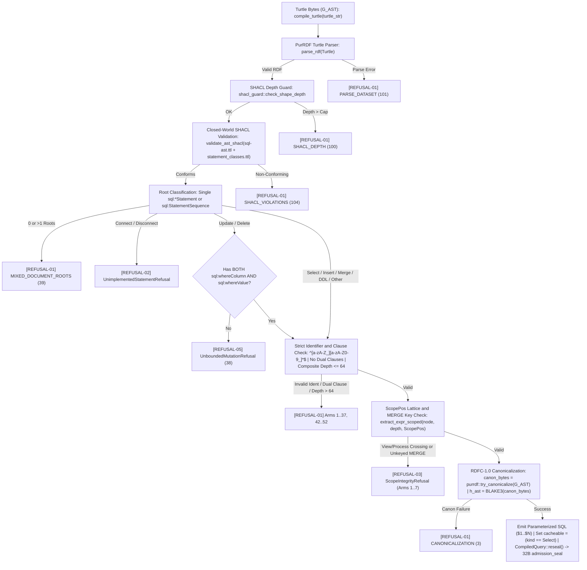

---

## Chapter 4: The GraphLaw Core WebAssembly Engine (`graphlaw-wasm`)

### 4.1 One Unit of Law: Why `frozen-duckdb` is Unconditionally Linked

A foundational architectural law of GraphLaw ([`CLAUDE.md`](file:///Users/sac/graphlaw/CLAUDE.md#L84-L87), [`Cargo.toml:70-74`](file:///Users/sac/graphlaw/Cargo.toml#L70-L74)) is that **DuckDB is not a feature flag**:
- In pre-v26.10.22 systems, analytical execution was gated behind `#[cfg(not(target_arch = "wasm32"))]`, causing the WASM artifact to silently reject `op="duckdb"` with `unknown op 'duckdb'` and forcing hosts to maintain an unverified external database bridge.
- In v26.10.22, `frozen-duckdb = "2.0.2"` is an unconditional dependency of the root `graphlaw` crate on every target, including `wasm32-wasip1`. The `graphlaw-wasm` crate (`wasm/Cargo.toml`) compiles and links the complete `graphlaw` kernel, `PurRDF 3.0.1` (including `purrdf-n3 3.0.1` from the pinned seanchatmangpt/purrdf fork), and `libduckdb.a` (`88,161,726 B` static archive) into a single, self-contained **57,781,384-byte** WebAssembly module (`priv/graphlaw.wasm`, BLAKE3 `fa1558306690493249b176ec312a4f01e97798937e05cd49f2946d61a7e6d107` [historical — interim pin superseded by 58a44095…d2280a]; digest/size reflect the pre-migration module (historical pin); re-measure at next wasm rebuild).

### 4.2 Ontology-Projected Linear-Memory ABI and the Side-Table Safety Contract

The WebAssembly FFI boundary in [`wasm/src/ffi.rs`](file:///Users/sac/graphlaw/wasm/src/ffi.rs) and [`wasm/src/abi_meta.rs`](file:///Users/sac/graphlaw/wasm/src/abi_meta.rs) is **never hand-edited**. It is projected by `ggen sync` from [`ontologies/graphlaw-wasm.ttl`](file:///Users/sac/graphlaw/ontologies/graphlaw-wasm.ttl) through the `rust-wasi-wasmex-pack` SPARQL queries and Tera templates, and pinned against `graphlaw::abi` via compile-time assertions ([`wasm/src/lib.rs:31-36`](file:///Users/sac/graphlaw/wasm/src/lib.rs#L31-L36)):

```rust
const _: () = {
    assert!(abi_meta::MAX_REQUEST_BYTES == graphlaw::abi::MAX_REQUEST_BYTES);
    assert!(abi_meta::MAX_OUTSTANDING_BYTES == graphlaw::abi::MAX_OUTSTANDING_ALLOC_BYTES);
    assert!(abi_meta::MAX_JSON_DEPTH == graphlaw::abi::MAX_JSON_DEPTH);
    assert!(abi_meta::ABI_VERSION == graphlaw::abi::ABI_VERSION);
};
```

#### The Side-Table Allocation Discipline (`LIVE: Mutex<BTreeMap<usize, Slot>>`)
In naive WebAssembly FFI shims, `free(ptr, len)` reconstructs a Rust vector via `Vec::from_raw_parts(ptr, len, len)`. That pattern is a critical vulnerability:
1. `Vec::capacity()` at allocation time may exceed `len`, so passing `len` as `capacity` causes heap metadata corruption (`dealloc` layout mismatch).
2. A buggy or hostile host passing a forged pointer, a mutated length, or a double-free triggers immediate undefined behavior (UB) inside linear memory.

GraphLaw's generated [`wasm/src/ffi.rs`](file:///Users/sac/graphlaw/wasm/src/ffi.rs#L80-L159) eliminates guest layout trust via the **Side-Table Contract**:
- Every buffer allocated by `gl_alloc(len)` or returned by `gl_call(ptr, len)` is registered in `LIVE: Mutex<BTreeMap<usize, Slot>>` before the pointer leaves the module:
  ```rust
  struct Slot {
      capacity: usize, // Real Vec::capacity() at publish time
      length: usize,   // Initialized prefix (>= 1, zero-filled)
      declared: u32,   // Exact length the host must pass back
      budget: usize,   // Bytes reserved in OUTSTANDING atomic counter
  }
  ```
- `OUTSTANDING: AtomicUsize` tracks total host-held bytes against `MAX_OUTSTANDING_BYTES = 16 MiB`. If `reserve(n)` would exceed 16 MiB, `gl_alloc` returns `null` (`0`) without allocating.
- When the host invokes `gl_call(ptr, len)` or `gl_free(ptr, len)`, `reclaim(ptr, len)` looks up `ptr as usize` in `LIVE` and verifies `slot.declared == len`:
  - **Null pointer (`Reject::Missing`):** Returns `missing_buffer_response()` JSON refusal; never traps.
  - **Forged or already-freed pointer (`Reject::Unknown`):** Returns `unknown_buffer_response()` JSON refusal (or no-op on `gl_free`); never reconstructs a `Vec`.
  - **Mismatched length (`Reject::Len`):** Leaves the allocation untouched in `LIVE` (so a subsequent `gl_free` with the true declared length can still reclaim it) and returns `unknown_buffer_response()`.
  - **Exact match:** Removes the `Slot` entry and reconstructs `unsafe { Vec::from_raw_parts(ptr, slot.length, slot.capacity) }` using the module's own recorded capacity.

#### Diagram 6: Host-to-WASM Linear Memory Lifecycle & Side-Table Verification

```mermaid
sequenceDiagram
    autonumber
    participant Host as Host Runtime (Wasmtime 48 / Elixir Wasmex / Node V8)
    participant FFI as wasm/src/ffi.rs (LIVE Side-Table & OUTSTANDING Cap)
    participant ABI as graphlaw::abi::call (Safe Rust Kernel)
    participant Engine as PurRDF / purrdf-n3 / frozen-duckdb

    Note over Host,Engine: Module Instantiation (_initialize / .init_array)
    Host->>FFI: Instantiate module & run .init_array ctors
    FFI->>Engine: graphlaw_wasm_register_static_extensions() -> Registers core_functions + icu into DuckDB

    Note over Host,FFI: Step 1: Reserve Request Buffer
    Host->>FFI: gl_alloc(req_len)
    alt req_len > 16 MiB or OUTSTANDING + req_len > 16 MiB
        FFI-->>Host: 0 (null_mut)
    else Within Budget
        FFI->>FFI: reserve(n) in OUTSTANDING, zero-fill vec![0u8; n], insert Slot into LIVE
        FFI-->>Host: req_ptr (i32)
    end

    Note over Host,Engine: Step 2: Write UTF-8 JSON & Invoke gl_call
    Host->>FFI: Write UTF-8 JSON bytes into LinearMemory[req_ptr .. req_ptr + req_len]
    Host->>FFI: gl_call(req_ptr, req_len)
    FFI->>FFI: reclaim(req_ptr, req_len) from LIVE
    alt Null / Unknown Ptr / Length Mismatch
        FFI->>ABI: missing_buffer_response() / unknown_buffer_response()
    else Valid Live Slot
        FFI->>FFI: Rebuild Vec from recorded (length, capacity) & release(budget)
        FFI->>ABI: graphlaw::abi::call(&request_bytes)
        ABI->>Engine: Dispatch op (capabilities, shacl, n3, law, duckdb, ...)
        Engine-->>ABI: Result<Value, Fail> (Receipt or Typed Refusal)
        ABI-->>FFI: UTF-8 JSON response Vec<u8> (never empty)
    end
    FFI->>FFI: Reserve response budget & publish(resp_vec) into LIVE
    FFI-->>Host: packed_u64 = (out_ptr << 32) | out_len

    Note over Host,FFI: Step 3: Read Response & Reclaim
    Host->>FFI: Read LinearMemory[out_ptr .. out_ptr + out_len]
    Host->>FFI: gl_free(out_ptr, out_len)
    FFI->>FFI: reclaim(out_ptr, out_len) -> drop(buf) & release(budget)
```

### 4.3 Solving the WebAssembly C++ Exception Handling & Reactor Impasse (`SQLRDF-24`)

Linking an 88 MiB C++ analytical engine (`frozen-duckdb`) into a `wasm32-wasip1` Rust module exposed two deep systems-level incompatibilities documented in [`docs/explanation/eh-closure-story.md`](file:///Users/sac/graphlaw/docs/explanation/eh-closure-story.md) and [`wasm/src/lib.rs`](file:///Users/sac/graphlaw/wasm/src/lib.rs#L38-L128):

#### Problem 1: The Legacy vs. W3C Standardized Exception-Handling Split
WebAssembly has two incompatible exception-handling (EH) instruction sets:
- **Legacy EH:** Uses structured `try` / `catch` / `delegate` instructions. Clang 24's `-fwasm-exceptions` flag defaulted to emitting legacy EH when lowering C++ exceptions.
- **Standardized W3C EH (Section 13):** Replaces legacy blocks with `try_table` (branch-target tables) and a `Tag` section (`Tag(13)`).

When `libduckdb.a`, `libunwind.a`, and `libc++abi.a` carried legacy `try` opcodes (or a mixed legacy+new link), **every host runtime refused the module**:
- `wasmi 2.0.0` rejected the `Tag` section outright (no EH support).
- `wasmtime 48` rejected legacy instructions (`legacy_exceptions feature required`, removed in modern Wasmtime).
- `Node 26 (V8)` rejected mixed legacy+new EH modules.

#### Problem 2: WASI Command Export Destructor Walk (`__funcs_on_exit` Trap)
Even after unifying the instruction set, the first `gl_call` trapped with `uninitialized element` on an indirect call to table slot 0 inside `wasi-libc`'s `__funcs_on_exit`. Root-cause analysis revealed two compounding mechanisms:
1. `rustc` wraps every `wasm32-wasip1` `cdylib` export (`gl_alloc`, `gl_call`, `gl_free`) in a `<name>.command_export` shim that invokes `__wasm_call_dtors` after **every single export call**.
2. With `frozen-duckdb` linked in, that post-call destructor walk executed DuckDB's C++ static destructors (`__cxa_atexit` table) between `gl_alloc` and `gl_call`, destroying live engine statics and triggering a stale `slot` cursor bug in musl's `atexit.c.obj` walker.
3. Simultaneously, `wasm-ld --gc-sections` stripped `libcore_functions_extension.a` and `libicu_extension.a` because nothing in the static link referenced `duckdb_extension_core_functions_describe`, causing `SUM`/`COUNT` to fail at runtime.

#### The Four-Part Sovereign WASM Closure (`wasm/src/lib.rs`)
GraphLaw resolves all three failure modes permanently:
1. **Uniform W3C New-EH Archive Rebuild:** `libduckdb.a`, `libunwind.a`, and `libc++abi.a` are compiled with `-fwasm-exceptions -mllvm -wasm-use-legacy-eh=0`. Opcode verification (`scripts/wasm_audit.sh`) enforces `try_table = 99` and `legacy try = 0` with `Tag(13) = 1`.
2. **`.init_array` Static Extension Registration ([`wasm/src/lib.rs:56-94`](file:///Users/sac/graphlaw/wasm/src/lib.rs#L56-L94)):** A `#[used] #[unsafe(link_section = ".init_array")]` constructor calls `graphlaw_wasm_register_static_extensions()`, which pulls `duckdb_extension_core_functions_describe` and `duckdb_extension_icu_describe` into the link as GC roots and registers them via `duckdb_register_static_extension` before the first session opens.
3. **Reactor Contract `atexit` No-Op Overrides ([`wasm/src/lib.rs:109-127`](file:///Users/sac/graphlaw/wasm/src/lib.rs#L109-L127)):** `wasm/src/lib.rs` exports `#[unsafe(no_mangle)]` overrides for `__cxa_atexit`, `__cxa_finalize`, `__funcs_on_exit`, and `atexit` as no-ops (paired with updated `wasi-libc` `atexit.c.obj`). Because `graphlaw-wasm` is a long-lived reactor rather than a one-shot CLI command, C++ static objects survive for the lifetime of the WASM instance and never tear down mid-session.
4. **Dual-Tier Host Posture:** [`graphlaw-run-eh`](file:///Users/sac/graphlaw/src/bin/graphlaw_run_eh.rs) (`wasmtime 48` with `Config::wasm_exceptions(true)`) hosts the 57.78 MiB DuckDB-linked production module; [`graphlaw-run`](file:///Users/sac/graphlaw/src/bin/graphlaw_run.rs) (`wasmi 2.0.0`) is retained exclusively for the historical 6.8 MiB pre-DuckDB court tier.

#### Diagram 7: W3C Exception Handling & Reactor Lifecycle Architecture in `graphlaw-wasm`

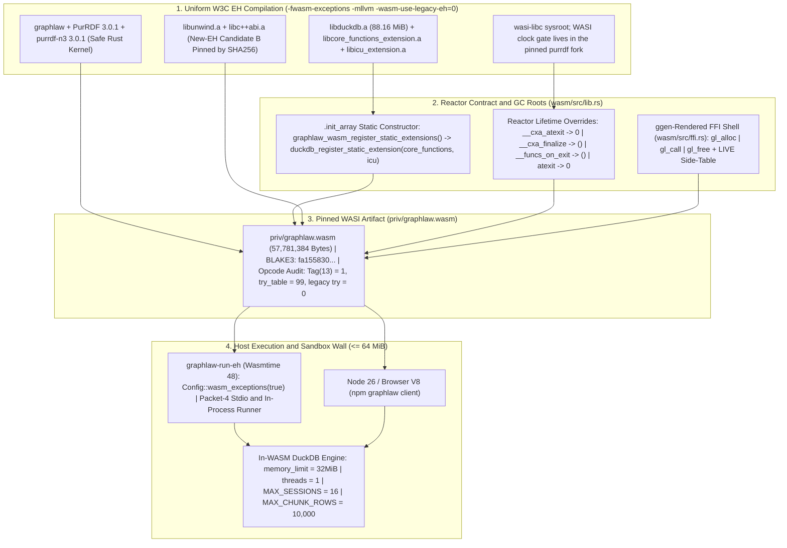

---

## Chapter 5: In-Module Relational Execution (`duckdb` Op-15), Receipt Algebra, and Caching

### 5.1 The Two-Node Anchored Query Hash ($H_{\text{query}}$)

Per `sql-rdf` Recommendation §1.4 and P28-SIL §3.1, every admitted relational query is identified by a deterministic 32-byte BLAKE3 digest binding the canonical AST graph to its typed parameter vector.

To avoid re-canonicalizing the RDF graph or cloning a ~2 KiB streaming `blake3::Hasher` state on every execution, GraphLaw implements the **Two-Node Anchored Formula** ([`src/duckdb_eval.rs:642-676`](file:///Users/sac/graphlaw/src/duckdb_eval.rs#L642-L676)):

1. **Compile-Time Structural Anchor ($h_{\text{ast}}$):** Computed exactly once inside `compile_turtle` and stored in `CompiledQuery::receipt_state: Option<[u8; 32]>`:
   $$h_{\text{ast}} = \mathrm{BLAKE3}\!\left(\mathrm{RDFC\text{-}1.0}(G_{\text{AST}})\right)$$
2. **Evaluation-Time Parameter Fold ($H_{\text{query}}$):** Computed per execution by [`fold_params_anchored`](file:///Users/sac/graphlaw/src/duckdb_eval.rs#L642-L660):
   $$H_{\text{query}} = \mathrm{BLAKE3}\!\left(h_{\text{ast}} \mathbin{\Vert} P_{\text{params}}\right)$$
   where $P_{\text{params}}$ is the type-tagged parameter buffer in bind order (each `SqlLiteral` encoded as a 1-byte discriminant tag followed by little-endian value bytes). When $|P_{\text{params}}| \le 64\text{ bytes}$ (`PARAM_BYTES_INLINE`), `fold_params_anchored` copies $h_{\text{ast}}$ and $P_{\text{params}}$ into a single 96-byte stack buffer `[u8; 32 + 64]` and executes a single `Hasher::update` + `finalize` with zero heap allocations.

**Theorem 5.1 (Properties of $H_{\text{query}}$).**
1. **Cosmetic Invariance:** Any two Turtle documents $D_1, D_2$ that parse to isomorphic AST graphs ($G_1 \cong G_2$) under identical parameter bindings $P$ satisfy $\mathrm{RDFC\text{-}1.0}(G_1) = \mathrm{RDFC\text{-}1.0}(G_2) \implies H_{\text{query}}(D_1, P) = H_{\text{query}}(D_2, P)$ (witnessed across the 5-variant cosmetic-invariance court `SQLRDF-09`).
2. **Semantic & Parametric Sensitivity:** Any mutation to an AST predicate, operator, scope annotation, parameter type tag, or parameter value alters either $h_{\text{ast}}$ or $P_{\text{params}}$, forking $H_{\text{query}}$ up to BLAKE3 collision resistance ($2^{-256}$).
3. **Witness Separation:** $H_{\text{query}}$ (what was admitted) is domain-separated from the post-execution state-readback witness (`h_triples` / `h_columnar`) and from `COPY ... TO` file export digests (`artifact_digest_hex`). Thus, an admitted statement retains a stable replay identity across executions while its output witnesses prove the exact data materialized.

### 5.2 C1 Standing-Addressed Query Cache and Monotonic Epoch Invalidation

Because $H_{\text{query}}$ uniquely identifies both the relational algebra tree and its bound parameters, [`QueryCache`](file:///Users/sac/graphlaw/src/query_cache.rs#L48-L158) uses $H_{\text{query}}$ as a content-addressed cache key mapping `[u8; 32] -> CacheEntry`:

```rust
pub struct CacheEntry {
    pub h_query: [u8; 32],
    pub receipt: ExecutionReceipt,
    pub grounding: Vec<u8>, // Canon(G_AST) bytes for auditor verification
    pub epoch: u64,         // Live catalog epoch at store time
    pub stored_at: u64,
}
```

Soundness is maintained by three invariants:
1. **Compile-Time Cacheability Gate (`C1-a`):** Only `sql:SelectStatement` sets `compiled.cacheable = true`. All other 34 statement classes (and all hand-built structures) carry `cacheable = false` and can never be stored in `QueryCache`.
2. **Monotonic Epoch Invalidation:** `QueryCache` maintains an atomic counter `epoch: AtomicU64`. Every mutating operation—any `INSERT`, `UPDATE`, `DELETE`, `MERGE`, `CREATE`, `ALTER`, `DROP`, `COPY`, `ATTACH`, `DETACH` ([`mutating_sql`](file:///Users/sac/graphlaw/src/duckdb_eval.rs#L687-L699)), or view registration (`register_parquet_view`, `register_csv_view`)—flushes prepared statement handles and calls `cache.bump()`, which clears the entry map and increments `epoch` with `Ordering::AcqRel`.
3. **Grounding Verification & Poison Recovery:** `cache.consult(h_query, grounding)` returns a hit only if `entry.epoch == self.epoch()` and `entry.grounding == grounding`. Furthermore, `lock_entries()` recovers from mutex poisoning via `PoisonError::into_inner()` so an isolated thread panic never bricks the shared cache.

### 5.3 The `duckdb` (Op-15) Wire Protocol and Document Sequences

Inside `graphlaw::abi::call`, requests with `"op": "duckdb"` route to [`src/duckdb_op.rs`](file:///Users/sac/graphlaw/src/duckdb_op.rs) on both native and `wasm32-wasip1` targets. Op-15 implements a four-mode state machine (`open`, `exec`, `stream`, `close`) plus multi-statement document sequences (`sql:StatementSequence`):

- **Hardened Pragma Floor:** Every connection opened by `open_connection()` ([`src/duckdb_op.rs:126-134`](file:///Users/sac/graphlaw/src/duckdb_op.rs#L126-L134)) enforces compile-time constants that cannot be overridden from the wire:
  ```sql
  SET memory_limit='32MiB'; SET threads=1; SET preserve_insertion_order=false;
  ```
- **Session Registry (`MAX_SESSIONS = 16`):** Named in-memory connections (`{"op":"duckdb","mode":"open","session":"s1"}`) persist across `exec` frames so `CREATE TABLE` $\to$ `INSERT` $\to$ `SELECT` $\to$ `UPDATE` lifecycles execute stateful workflows inside WASM. Exceeding 16 concurrent sessions refuses with `RefusalKind::ResourceLimit`.
- **Fail-Closed `ATTACH` Policy (`GRAPHLAW_ATTACH_ROOTS`):** Any `AttachStatement` must resolve via `std::fs::canonicalize` under a colon-separated allowlist in `GRAPHLAW_ATTACH_ROOTS` ([`src/duckdb_op.rs:228-250`](file:///Users/sac/graphlaw/src/duckdb_op.rs#L228-L250)). When unset or empty, every `ATTACH` (including `':memory:'`) fails closed with a typed `DuckDb` refusal.
- **Bounded Cursor Pagination (`MAX_CHUNK_ROWS = 10,000`, `MAX_CHUNK_BYTES = 16 MiB`):** Large query results are chunked via `mode: "stream"` into N-Quads pages without exhausting the 16 MiB ABI allocation budget.
- **Document Sequences (`eval_ast_document`, [`src/duckdb_eval.rs:1104-1188`](file:///Users/sac/graphlaw/src/duckdb_eval.rs#L1104-L1188)):** An `sql:StatementSequence` executes an ordered `rdf:List` of statements with contiguous `sql:statementIndex` values ($1, 2, \dots, k$), supporting two transaction modes:
  1. **Pipeline Mode (`sql:atomic false`, default):** Best-effort sequential autocommit; if member $i$ fails, returns `EvaluatorError::BatchMemberFailed` carrying a `BatchReceipt` with `status: "partial"`, `state_delta: i`, and the receipts of members `[0..i]`.
  2. **Atomic Mode (`sql:atomic true`, `SQLRDF-26`):** Wraps the sequence in `BEGIN TRANSACTION` $\dots$ `COMMIT`; if member $i$ fails, executes `ROLLBACK` and returns a partial `BatchReceipt` with `status: "aborted"` and `state_delta: 0` (witnessed in the DvP Settlement court).

#### Diagram 8: `duckdb` Op-15 Session, Cursor Streaming, and `StatementSequence` State Machine

```mermaid
stateDiagram-v2
    [*] --> Idle

    state "Session Registry (MAX_SESSIONS = 16)" as Idle
    state "Active Session (32 MiB Cap, 1 Thread)" as SessionOpen
    state "Admission & Seal Verification" as Admitting
    state "C1 Cache Consult (Epoch-Checked)" as CacheCheck
    state "Single Statement Eval (eval_ast_query)" as SingleEval
    state "Document Sequence Eval (eval_ast_document)" as BatchEval
    state "Cursor Registered (rows > chunk_rows)" as CursorActive
    state "Typed Refusal Envelope (ok: false)" as Refused

    Idle --> SessionOpen: mode="open" {session: "s1"} -> enforce SET memory_limit='32MiB', threads=1
    Idle --> Refused: Duplicate session or > 16 sessions (ResourceLimit)
    Idle --> Admitting: mode="exec" (ephemeral per-call connection)
    SessionOpen --> Admitting: mode="exec" {session: "s1", ast: {turtle}}

    Admitting --> Refused: REFUSAL-01..05 | Wire params != AST literals | ATTACH outside allowlist
    Admitting --> CacheCheck: Single SelectStatement (verify_seal() == true)
    Admitting --> SingleEval: Single DML/DDL Statement (verify_seal() == true)
    Admitting --> BatchEval: sql:StatementSequence (1..k ordered members)

    CacheCheck --> SessionOpen: Hit at live epoch (2.541 us) -> Emit ExecutionReceipt
    CacheCheck --> SingleEval: Miss -> Prepare ($1..$N) & Execute on frozen-duckdb

    SingleEval --> SessionOpen: Mutating SQL -> Flush StmtCache + QueryCache::bump()
    SingleEval --> CursorActive: Select rows > chunk_rows -> Register cursor
    SingleEval --> SessionOpen: Select rows <= chunk_rows -> Emit ExecutionReceipt

    BatchEval --> SessionOpen: All members OK (COMMIT if atomic) -> Emit BatchReceipt
    BatchEval --> Refused: Member i fails + atomic=true -> ROLLBACK (state_delta=0, status="aborted")
    BatchEval --> Refused: Member i fails + atomic=false -> Partial Commit (state_delta=i, status="partial")

    CursorActive --> CursorActive: mode="stream" {cursor, max_rows <= 10,000} -> Page <= 16 MiB (more: true)
    CursorActive --> SessionOpen: Final page (more: false) or mode="close" {cursor}
    SessionOpen --> Idle: mode="close" {session: "s1"}
```

#### Diagram 9: Two-Node BLAKE3 Receipt Algebra ($H_{\text{query}}$) & Dual-Witness `ExecutionReceiptV2`

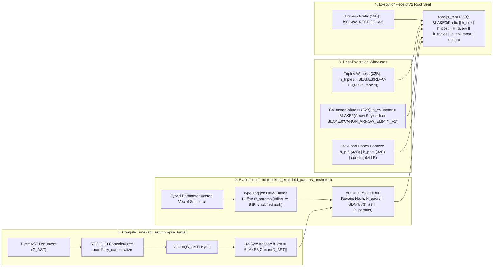

---

## Chapter 6: Evidentiary Ring, Chained Ledger, and CanonArrow Dual-Witness Egress

### 6.1 The Hot/Cold Evidentiary Split (`CoarseClock`, `EvidenceRing`, and `QueryLedger`)

Recording cryptographic audit trails synchronously on the database execution thread traditionally introduces syscall and disk-I/O latency spikes. GraphLaw decouples evidentiary persistence from query evaluation through a three-part hot/cold architecture:

1. **Amortized Monotonic Timing (`CoarseClock`, [`src/duckdb_eval.rs:27-61`](file:///Users/sac/graphlaw/src/duckdb_eval.rs#L27-L61)):** Calling `std::time::Instant::now()` twice per query costs ~41 ns on Apple Silicon. `coarse_now_ns()` replaces the entry timestamp with a single `Ordering::Relaxed` atomic load (`<10 ns` median), recalibrating against the real hardware clock every `COARSE_CALIB_EVERY = 64` reads via monotonic `fetch_max`, while `coarse_elapsed_ns(start_ns)` forces a real calibration on exit so reported durations preserve exact `Instant` accuracy.
2. **64-Byte Cache-Line `RingDescriptor` with Torn-Read Detection ([`src/evidence_ring.rs:49-116`](file:///Users/sac/graphlaw/src/evidence_ring.rs#L49-L116)):** Each executed query emits a `#[repr(C)]` 64-byte descriptor:
   ```rust
   #[repr(C)]
   pub struct RingDescriptor {
       pub h_query: [u8; 32],   // Offset 0..32: BLAKE3(Canon(G_AST) || P_params)
       pub rows_emitted: u64,   // Offset 32..40
       pub execution_ms: u32,   // Offset 40..44
       pub cached: u8,          // Offset 44..45 (1 = C1 hit, 0 = evaluated)
       pad1: [u8; 3],           // Offset 45..48: PRIVATE zero-invariant pad
       pub timestamp_ms: u64,   // Offset 48..56: Unix epoch ms
       pad2: [u8; 8],           // Offset 56..64: PRIVATE zero-invariant pad
   }
   ```
   The `pad1` and `pad2` fields are private and initialized to zero by `RingDescriptor::new`. Any memory corruption or torn read across the 64-byte boundary produces non-zero pad bytes (`!desc.pads_zero()`), which is immediately rejected with `RingError::TornSlot` (`tests/evidentiary_ring_court.rs` exercises this via `RingDescriptor::torn_via`).
3. **Wait-Free SPSC `EvidenceRing` and `DroppedEvidence` Sequence Accounting ([`src/evidence_ring.rs:38-350`](file:///Users/sac/graphlaw/src/evidence_ring.rs#L38-L350)):** The producer pushes `EvidenceSlot { seq, desc }` onto a 4096-slot lock-free `rtrb` ring (`RING_CAPACITY = 4096`, witnessed max push `292 ns`). Overflow policy is **drop-newest**: the producer never blocks, never spins, and never acquires a mutex. Instead, the producer increments an atomic sequence counter on every attempt; when the background drainer thread (`DRAIN_BATCH = 256`, `FSYNC_EVERY = 16`) observes a gap between consecutive `seq` numbers, it writes an explicit `DroppedEvidence` record into the BLAKE3-chained NDJSON ledger (`QueryLedger`, [`src/query_ledger/storage.rs`](file:///Users/sac/graphlaw/src/query_ledger/storage.rs)). Thus, even under extreme ring saturation, evidentiary loss is cryptographically bounded and auditable (`RingError::SequenceGap` if unaccounted).

#### Diagram 10: Hot/Cold Evidentiary Split — `CoarseClock`, SPSC `EvidenceRing`, and Chained NDJSON `QueryLedger`

```mermaid
flowchart TD
    subgraph HotPath["1. Hot Execution Thread (Producer - Wait-Free, Zero I/O)"]
        TickStart["start_ns = coarse_now_ns() (Relaxed Atomic Load, recalibrated every 64 reads)"]
        Eval["eval_member (C1 Hit or DuckDB Eval): H_query = BLAKE3(h_ast || P_params)"]
        TickEnd["elapsed = coarse_elapsed_ns(start_ns) -> Construct 64B RingDescriptor (pad1=0, pad2=0)"]
        SeqAlloc["seq = next_seq.fetch_add(1, Relaxed)"]
        Push{"rtrb Producer::push (4096-Slot RingBuffer)"}

        TickStart --> Eval --> TickEnd --> SeqAlloc --> Push
        Push -->|Slot Available (<= 292 ns)| ReturnCaller["Return ExecutionReceipt to Caller"]
        Push -->|Ring Full (Drop-Newest)| DropCounter["Increment dropped_count AtomicU64 (Never Block / Never Spin)"]
        DropCounter --> ReturnCaller
    end

    subgraph ColdPath["2. Background Drainer Thread (Consumer - Batch 256, fsync every 16)"]
        Pop["rtrb Consumer::pop -> EvidenceSlot { seq, desc }"]
        PadCheck{"desc.pads_zero()? (pad1 == [0;3] and pad2 == [0;8])"}
        GapCheck{"seq == expected_seq?"}
        EmitDrop["Append DroppedEvidence Line {from_seq: expected_seq, to_seq: seq - 1} and Advance parent_blake3"]
        EmitEvent["Append EvidenceEvent Line: Canonical JSON + parent_blake3 -> entry_blake3"]
        TornRefusal["RingError::TornSlot: Halt and Refuse Corrupted Stream"]
        LedgerFile[("Append-Only NDJSON Ledger: Linear BLAKE3 Parent -> Child Chain")]

        Push -.->|Lock-Free SPSC| Pop
        Pop --> PadCheck
        PadCheck -->|Non-Zero Pad| TornRefusal
        PadCheck -->|Zero Pads Valid| GapCheck
        GapCheck -->|seq > expected_seq| EmitDrop --> EmitEvent
        GapCheck -->|Contiguous| EmitEvent
        EmitEvent --> LedgerFile
    end
```

### 6.2 Overcoming the 6.83× N-Triples Egress Tax: `CanonArrow` Dual-Witness Protocol

Benchmarking in `benches/sql_rdf_egress.rs` (`docs/whitepaper-v26.10.22.md` §3) established that materializing 10,000 rows from `frozen-duckdb` takes **1.354 ms**, whereas formatting those rows into canonical N-Triples text strings costs **9.246 ms**—a **6.83× serialization tax**.

To eliminate text marshalling across the WASM linear-memory boundary while preserving RDF semantic verifiability, GraphLaw introduces the **`CanonArrow` Dual-Witness Columnar Egress Protocol** ([`src/egress/arrow.rs`](file:///Users/sac/graphlaw/src/egress/arrow.rs) and [`crates/graphlaw-reconstituted/src/lib.rs`](file:///Users/sac/graphlaw/crates/graphlaw-reconstituted/src/lib.rs)):

- **`ArrowEgressHeader` (`128 bytes`, `#[repr(C, align(64))]`):** Occupies exactly two 64-byte CPU cache lines at the start of the egress buffer (`payload_offset = 128`), carrying both the RDF triples witness (`triples_digest: [u8; 32]`) and the zero-copy Arrow IPC payload witness (`columnar_digest: [u8; 32]`).
- **Domain Null Digest (`CANON_ARROW_EMPTY_V1`):** For non-tabular transitions, `h_columnar` is bound to `BLAKE3(b"CANON_ARROW_EMPTY_V1")` so `ExecutionReceiptV2` maintains a uniform 7-field structure without ambiguity.

#### Diagram 11: Exact Memory Layout of `ArrowEgressHeader` (128B), `RingDescriptor` (64B), and Receipt Structures

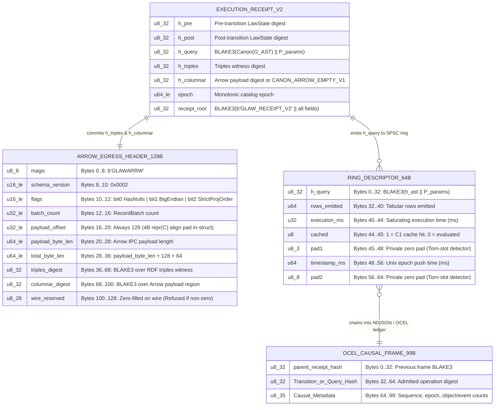

---

## Chapter 7: Qualification Algebra, Adversarial Courts, and Empirical Evaluation

### 7.1 The Qualification Algebra $Q = (S, C, A, O, P, E, H)$

In GraphLaw ([`docs/QUALIFICATION_ALGEBRA.md`](file:///Users/sac/graphlaw/docs/QUALIFICATION_ALGEBRA.md), [`src/qualification.rs`](file:///Users/sac/graphlaw/src/qualification.rs)), verification is formalized not as an assertion suite, but as an executable falsification relation over an exact subject:

$$Q = (S, C, A, O, P, E, H)$$

- **$S$ (Subject Identity):** Exact repository commit SHA and artifact BLAKE3 digests (`priv/graphlaw.wasm`, `registry/ARTIFACTS.blake3`, `contracts/abi-manifest.json`).
- **$C$ (Inherited Court Set):** Profiles compose by set union of courts ($C_{\text{child}} \supseteq C_{\text{parent}}$); a domain profile (such as FIBO banking) can add stricter postconditions but can never silently drop an inherited boundary, mutation, or replay court.
- **$A$ (Adversarial Attempt Family):** Hostile inputs and inline anti-vacuity mutations (`tests/k5_hostile_sqlrdf.rs`, `tests/k6_hostile_lease.rs`, `tests/sql_rdf_laundering_corpus.rs`, `tests/reconstitution_sabotage_court.rs`).
- **$O$ (Independent Observers):** Out-of-process verifiers (`graphlaw-verify`, `pm4pytest` external oracle, `tests/two_verifier_court.rs`).
- **$P$ (Temporal & Process Postconditions):** Monotonic epoch ordering, atomic batch rollback (`state_delta == 0`), Petri-net trace fitness $\kappa = 1.0$.
- **$E$ (Durable Evidence Projection):** Embedded command outputs, exit codes, and `CHAIN.blake3` receipts.
- **$H$ (Standing Ceiling):** Ordered in the bounded lattice:
  $$\mathsf{UNQUALIFIED} < \mathsf{OBSERVED} < \mathsf{ATTACKED} < \mathsf{QUALIFIED}$$
  A court is **non-vacuous** if and only if $\mathsf{AttemptObserved} \land \neg \mathsf{ViolationObserved}$. A court whose gate does not flip when the underlying check is inverted or sabotaged is classified as `VACUOUS` (FAIL).

### 7.2 Empirical Performance Envelope & Court Results

The table below synthesizes the witnessed empirical measurements and court standings across the `v26.10.22` tree:

| Subsystem / Benchmark | Measured Value | Court / Receipt Source | Standing & Interpretation |
| :--- | :--- | :--- | :--- |
| **C1 Query-Identity Cache Hit** | **`2.541 µs` median** | `benches/workload_amortization.rs`, `docs/whitepaper-v26.10.22.md` §3 | **`WITNESSED`**: `BLAKE3(h_ast \|\| P_params)` fold + epoch-valid `QueryCache::consult` hit; zero DuckDB engine contact. |
| **Raw `frozen-duckdb` Prepared Execution** | **`117.4 µs` median** | `benches/sql_rdf_engine.rs`, `receipts/2026-10-23-engine-baseline.md` | **`WITNESSED`**: Pre-compiled physical plan execution floor in embedded DuckDB. |
| **Cold Graph-Backed Admission + Eval** | **`23.13 ms` median** (`16.42 ms` fresh conn) | `benches/sql_rdf_compiler.rs`, `receipts/2026-10-23-engine-baseline.md` | **`WITNESSED`**: Full Turtle parse + SHACL recursion guard + closed-world SHACL validation + `compile_turtle` + RDFC-1.0 canon + DuckDB prepare/execute (**9,100×** slower than C1 hit, proving admission amortization). |
| **Hot-Path BLAKE3 Parameter Fold** | **`184–216 ns/op` isolated** (`250–300 ns` fan-out; p99 `375 ns`) | `tests/p28_hot_path_bench.rs`, `receipts/spc-2026-10-22.json` | **`DISCLOSED FAIL` on SPC Gate**: Smoke median (`~0.20 µs`) is below the `0.25 µs` USL, but p99 (`375 ns`) under fleet contention yielded `Cpk = -0.0018` (`FAIL`). Carried transparently per doctrine. |
| **SPSC `EvidenceRing` Producer Push** | **`<= 292 ns` max** (vs `10 µs` fence) | `tests/evidentiary_ring_court.rs`, `docs/jira/v26.10.22/DISSERTATION.md` §6.2 | **`WITNESSED`**: Wait-free 64-byte `RingDescriptor` push into 4096-slot `rtrb` ring. |
| **Columnar Egress Serialization Tax** | **`1.354 ms`** (raw) vs **`9.246 ms`** (N-Triples) per 10k rows | `benches/sql_rdf_egress.rs`, `docs/whitepaper-v26.10.22.md` §3 | **`WITNESSED`**: Empirical **6.83×** text-rendering overhead motivating `CanonArrow` 128B dual-witness egress. |
| **WASM Module Size & Sandbox Wall** | **`57,781,384 B`** (`55.10 MiB` <= `64 MiB` ceiling) | `tests/wasm_size_court.rs`, `registry/ARTIFACTS.blake3` | **`WITNESSED`**: Full `graphlaw` + `PurRDF` + `purrdf-n3` + `frozen-duckdb` + `core_functions` + `icu` with W3C EH (`Tag(13) = 1`). Digest/size reflect the pre-migration module (historical pin); re-measure at next wasm rebuild. |
| **In-WASM Memory-Wall Plateau** | **8/8 green** ($\Delta \le 2$ pages/cycle) | `tests/wasm_memory_wall.rs`, `tests/wasm_boundary_fuzz.rs` (1,172 frames) | **`WITNESSED`**: Bounded linear memory growth across repeated cycles with zero leaks or OOM traps. |
| **FIBO Banking Domain Courts (Wasmtime 48)** | **4/4 suites green** (BCBS 239, Rehypothecation, UBO Sanctions, DvP Settlement) | `tests/bcbs_aggregation_court.rs`, `tests/rehypothecation_gate_court.rs`, `tests/ubo_sanctions_court.rs`, `tests/dvp_settlement_court.rs` | **`WITNESSED`**: Full financial ontology + SQL-in-RDF analytical verification including atomic batch rollback on DvP leg failure. |

#### Diagram 12: Empirical Latency Profile Across Execution Paths (Microseconds, Log-Conceptual Comparison)

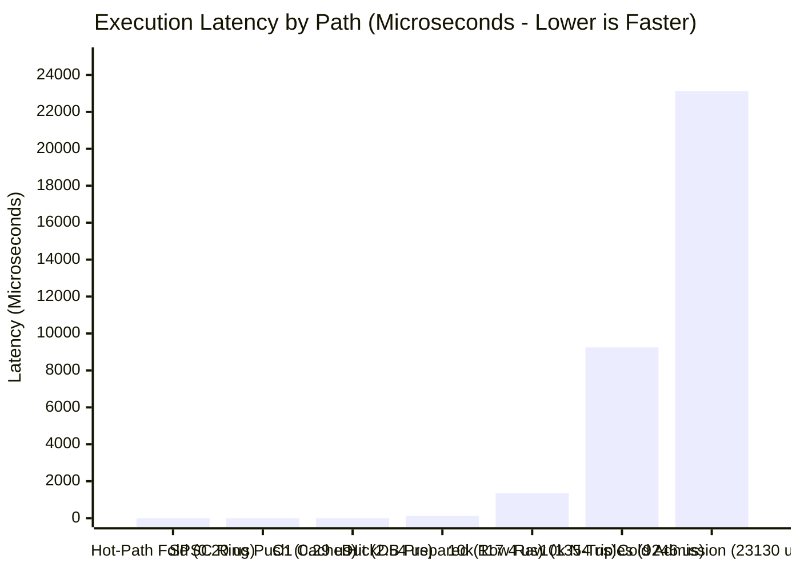

---

## Chapter 8: The 1000× ERRC Horizon, Clean-Room Reconstitution, and Conclusion

### 8.1 The Eight ERRC Phase-Change Moonshots

Part II of [`docs/jira/v26.10.22/THESIS.md`](file:///Users/sac/graphlaw/docs/jira/v26.10.22/THESIS.md#L76-L120) defines the eight-part Eliminate-Reduce-Raise-Create (ERRC) horizon that transitions `sql-rdf` from a verified compiler to a self-hosting single-description substrate, ordered by strict falsifier dependencies:

1. **Chain 1 (`E1` $\to$ `A1` $\to$ `E2` $\to$ `E3`):**
   - **`E1` (Eliminate the Alias Window):** Remove the dual-vocabulary compatibility window (`sql:selectList` vs. `sql:select`, `sql:fromTable` vs. `sql:from`, `sql:whereClause` vs. `sql:where`, `sql:havingClause` vs. `sql:having`) so alias-laundering attacks are unrepresentable by construction.
   - **`A1` (Raise Scope to a Type):** Compute positional classes (`sql:ViewExpression`, `sql:ProcessExpression`) via SHACL entailment rules in a validation-scoped closure so scope violations are rejected by the shape layer before compiler extraction.
   - **`E2` (Shapes as Single Description; Generate the Compiler):** Project the property-path reader in `src/sql_ast.rs` directly from `ontologies/sql-ast.ttl` via `ggen` so grammar drift between SHACL shapes and Rust extraction becomes a compile error.
   - **`E3` (Executable Conformance):** Bind every clause of [`docs/reference/sql-rdf-rec.md`](file:///Users/sac/graphlaw/docs/reference/sql-rdf-rec.md) to an executable court in [`tests/sql_rdf_conformance.rs`](file:///Users/sac/graphlaw/tests/sql_rdf_conformance.rs), emitting [`docs/reference-generated/sql-rdf-conformance.md`](file:///Users/sac/graphlaw/docs/reference-generated/sql-rdf-conformance.md) automatically.
2. **Chain 2 (`R1` $\to$ `C1`):**
   - **`R1` (Reduce Re-Canonicalization Cost):** Pre-carry `Canon(G_AST)` and `h_ast = BLAKE3(Canon(G_AST))` on `CompiledQuery` (landed in `src/sql_ast/ast.rs:572-582`) and extend to subgraph-incremental canonicalization.
   - **`C1` (Create Standing-Addressed Cache):** Cache execution receipts by `(H_query, epoch)` across connections (`src/query_cache.rs`, landed in-process).
3. **Chain 3 (`R2` $\to$ `C2`):**
   - **`R2` (Reduce Feature Flags to Capability Queries):** Query `registry/capability-registry.json` and the admission tier lattice dynamically rather than branching on compile-time `#[cfg]` gates.
   - **`C2` (Create SQL-RDF as Sole Wire Format):** Eliminate all raw-SQL text ingress (`SQLRDF-17` deleted raw-SQL hash fallback and `ast.text` wire admission), leaving canonical graph admission as the only door into the engine.

### 8.2 Clean-Room Reconstitution and Observable Equivalence Courts

In [`authority/v26.9.28/graphlaw-observable-contract.json`](file:///Users/sac/graphlaw/authority/v26.9.28/graphlaw-observable-contract.json) and [`crates/graphlaw-reconstituted/`](file:///Users/sac/graphlaw/crates/graphlaw-reconstituted/src/lib.rs), GraphLaw demonstrates how an entire law-admission kernel's observable contract can be extracted into a machine-readable specification and verified via two adversarial courts:
- [`tests/reconstitution_equivalence_court.rs`](file:///Users/sac/graphlaw/tests/reconstitution_equivalence_court.rs): Proves byte-identical behavioral equivalence between the primary kernel and the clean-room reconstituted crate (`ExecutionReceiptV2::seal`, `compute_h_query`, `CanonArrow` egress, runner exit codes, and security guards).
- [`tests/reconstitution_sabotage_court.rs`](file:///Users/sac/graphlaw/tests/reconstitution_sabotage_court.rs): Injects deliberate mutations into the reconstituted primitives (`RECEIPT_V2_PREFIX`, `h_query` domain separation, header flags) and proves the equivalence court flips to `FAIL` with zero vacuity.

#### Diagram 13: The 1000× ERRC Moonshot Dependency DAG & Reconstitution Equivalence Loop

```mermaid
flowchart TD
    subgraph Chain1["Structural Closure Chain (E1 -> A1 -> E2 -> E3)"]
        E1["E1: Eliminate Alias Window (Single Predicate per Clause in sql-ast.ttl)"]
        A1["A1: Raise Scope to SHACL Type (Entailed ViewExpression vs ProcessExpression)"]
        E2["E2: Shapes as Single Description (ggen Projects Compiler Reader from SHACL)"]
        E3["E3: Executable Conformance (Spec Clauses == tests/sql_rdf_conformance.rs)"]
        E1 -->|Closes Alias Laundering| A1
        A1 -->|Enforces Scope in Shapes| E2
        E2 -->|Eliminates Grammar Drift| E3
    end

    subgraph Chain2["Identity and Amortization Chain (R1 -> C1)"]
        R1["R1: Compile-Time Canon and Anchor (h_ast = BLAKE3(Canon(G_AST)) on CompiledQuery)"]
        C1["C1: Standing-Addressed QueryCache (9,100x Median Speedup: 23.13 ms -> 2.541 us)"]
        R1 -->|O(1) Anchor Copy per Eval| C1
    end

    subgraph Chain3["Sovereign Wire Closure Chain (R2 -> C2)"]
        R2["R2: Capability Lattice Query (Zero #[cfg] Target Gating; One WASM Unit)"]
        C2["C2: SQL-RDF as Sole Wire Format (SQLRDF-17: Raw SQL Refused; Seal Verified)"]
        R2 -->|Uniform Host and WASM Surface| C2
    end

    subgraph Reconstitution["Clean-Room Reconstitution and Dual-Witness Egress"]
        Contract["Observable Contract: authority/v26.9.28/graphlaw-observable-contract.json"]
        ReconCrate["crates/graphlaw-reconstituted: ExecutionReceiptV2 + CanonArrow + Security"]
        EquivCourt["tests/reconstitution_equivalence_court.rs + tests/reconstitution_sabotage_court.rs"]
        E3 --> Contract
        C1 --> Contract
        C2 --> Contract
        Contract --> ReconCrate --> EquivCourt
    end
```

---

## 9. Chapter 9: Knowledge Hooks & Deductive-Relational Builtins

### 9.1 The `kh:Hook` Stratified Fixpoint Engine (`src/hooks.rs`)

While `LawState::apply` ([`src/law.rs`](file:///Users/sac/graphlaw/src/law.rs)) provides atomic, single-step state transitions, autonomic governance requires reactive rule chains that fire deterministically when patterns emerge in the knowledge graph. [`src/hooks.rs`](file:///Users/sac/graphlaw/src/hooks.rs) implements the **Knowledge Hook (`kh:`)** subsystem (`http://graphlaw.io/kh#`), turning SPARQL `SELECT` triggers and `CONSTRUCT` actions into a bounded, stratified fixpoint loop.

1. **Hook Declaration & Parsing ([`Hook::from_law`](file:///Users/sac/graphlaw/src/hooks.rs#L118-L212)):**
   A hook is declared in RDF as an instance of `kh:Hook` with:
   - `kh:hasTrigger` $\to$ `kh:Trigger` (`kh:condition`: SPARQL `SELECT` query; optional `kh:priority`: integer priority, default `0`).
   - `kh:hasAction` $\to$ `kh:Action` (`kh:effect`: `kh:EmitDelta` or `kh:Refuse`; `kh:template`: SPARQL `CONSTRUCT` query for `EmitDelta`; `kh:reason`: diagnostic string for `Refuse`).
   Hooks are sorted deterministically by `(priority, iri)` ([`src/hooks.rs:208`](file:///Users/sac/graphlaw/src/hooks.rs#L208)). Lower priority integers fire in earlier strata.

2. **Lineage-Based Firing Deduplication ([`firing_key`](file:///Users/sac/graphlaw/src/hooks.rs#L351-L361)):**
   To guarantee termination without cyclic re-firing on the same variable bindings, every `(hook_iri, canonical_binding_row)` pair is hashed via BLAKE3 into a synthetic lineage triple injected directly into the working `MemStore`:
   $$
   \langle \text{urn:graphlaw:hook-firing:}\mathrm{BLAKE3}(h_{\text{iri}} \mathbin{\Vert} \text{row}),\; \text{kh:fired},\; \text{"1"} \rangle
   $$
   Before firing a hook for a binding row, [`evaluate`](file:///Users/sac/graphlaw/src/hooks.rs#L218-L342) checks `work.contains(&marker)`. Because the lineage marker lives inside the working RDF store, a hook fires at most once per distinct binding tuple across the entire fixpoint evaluation.

3. **Fuse Refusal Semantics & Resource Caps:**
   - **Resource Bounds:** `MAX_ROUNDS = 64` ([`src/hooks.rs:24`](file:///Users/sac/graphlaw/src/hooks.rs#L24)), `MAX_FIRINGS = 10_000` ([`src/hooks.rs:28`](file:///Users/sac/graphlaw/src/hooks.rs#L28)), and `MAX_STATE_QUADS = 1_000_000` ([`src/hooks.rs:32`](file:///Users/sac/graphlaw/src/hooks.rs#L32)). Exceeding any bound returns [`HookError::FixpointNotReached`](file:///Users/sac/graphlaw/src/hooks.rs#L74) or [`HookError::QuotaExceeded`](file:///Users/sac/graphlaw/src/hooks.rs#L76).
   - **Fuse (`Effect::Refuse`):** When a hook with `kh:effect kh:Refuse` matches a binding row, evaluation halts immediately and returns [`HookOutcome::Refused`](file:///Users/sac/graphlaw/src/hooks.rs#L101-L107) while **preserving the original `LawState` untouched** ($O^*_{t+1} = O^*_t$).
   - **Receipted Convergence (`Effect::EmitDelta`):** When a round completes with zero new firings, all lineage markers are stripped from the delta and the accumulated `CONSTRUCT` triples are committed through a single `state.apply(Step::Construct { query }, Ceiling::Construct)` call, producing one canonical [`Receipt`](file:///Users/sac/graphlaw/src/law.rs#L80-L92) for the entire fixpoint cascade.

#### Diagram 14: The `kh:Hook` Stratified Fixpoint & Lineage Deduplication Loop

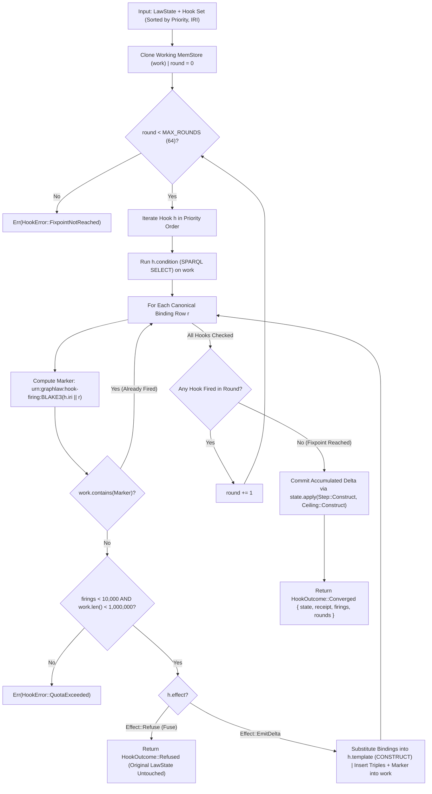

### 9.2 The Deductive-Relational Bridge (`src/rules/builtins.rs` — `gl:evalSql`)

A central research contribution of GraphLaw is unifying **Tier 2 (`N3Logic`)** deductive reasoning with **Tier 3 (`Relational`)** vectorized analytical execution without breaking the closed-world RDF AST compilation boundary. [`src/rules/builtins.rs`](file:///Users/sac/graphlaw/src/rules/builtins.rs) implements [`builtin_eval_sql`](file:///Users/sac/graphlaw/src/rules/builtins.rs#L140-L246) (IRI `http://graphlaw.io/ns#evalSql`), allowing an N3 rule antecedent to invoke a `sql:SelectStatement` node stored in the RDF graph and bind its execution provenance and relational output back into the deductive store.

1. **Document-Backed Provenance Gate (`REFUSAL-04`):**
   `builtin_eval_sql` accepts an [`RdfAstGraphReader`](file:///Users/sac/graphlaw/src/rules/builtins.rs#L65-L98) over the active graph. If `graph.query_document_turtle(subject)` returns `None`—meaning the `sql:SelectStatement` node was synthesized in-memory without an authoritative Turtle document backing—the builtin refuses immediately with `REFUSAL-04` (`UnboundIdentifier`: *"rule builtin gl:evalSql requires a document-backed sql:SelectStatement subject"*). This makes it structurally impossible for an N3 rule to synthesize an unverified SQL AST bypassing `compile_turtle`.
2. **Compile $\to$ Seal $\to$ Evaluate:**
   When document-backed, `builtin_eval_sql` calls `compile_turtle(turtle)` ([`src/rules/builtins.rs:176`](file:///Users/sac/graphlaw/src/rules/builtins.rs#L176)) and `eval_compiled(&compiled, &params, &EvalConfig::default())` ([`src/rules/builtins.rs:189`](file:///Users/sac/graphlaw/src/rules/builtins.rs#L189)).
3. **Variable Binding & Derived Triple Materialization:**
   On success, the builtin binds three N3 variables in the rule environment:
   - `?receipt` $\leftarrow$ `<urn:blake3:...>` (`receipt_iri`)
   - `?rowsEmitted` $\leftarrow$ integer count of relational rows
   - `?queryHash` $\leftarrow$ 64-hex $H_{\text{query}}$
   Simultaneously, it materializes three RDF triples into `derived_triples`: `(subject, gl:lastReceipt, <urn:blake3:...>)`, `(<urn:blake3:...>, gl:rowsEmitted, rows)`, and `(<urn:blake3:...>, gl:queryHash, hex)`.

#### Diagram 15: The `builtin_eval_sql` (`gl:evalSql`) Deductive-to-Relational Bridge

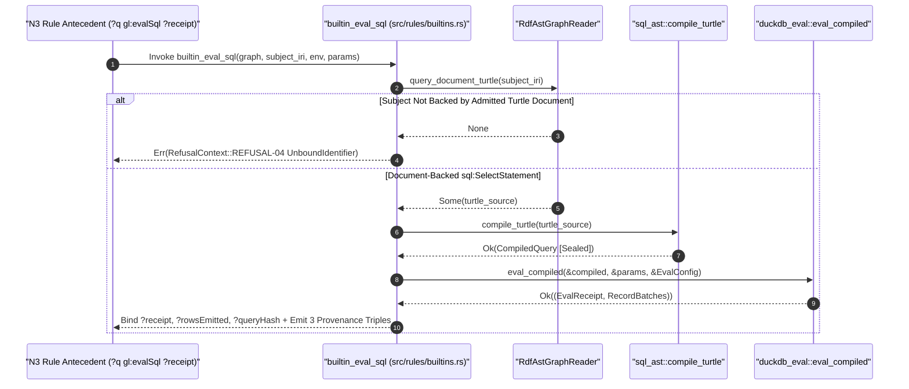

---

## 10. Chapter 10: Ground Action Plan Replay & FOND Strong-Cyclic Policy Admission

### 10.1 Ground Action Plan Replay (`src/plan.rs`)

When an external automated planner (such as `ferroplan` or a PDDL solver) synthesizes a sequence of actions, GraphLaw treats the solver's output as untrusted raw observation ($O$). [`src/plan.rs`](file:///Users/sac/graphlaw/src/plan.rs) provides the deterministic state-space verifier ([`Plan::admit`](file:///Users/sac/graphlaw/src/plan.rs#L211-L263)) that elevates a candidate plan into $O^*$ and commits its net state transition under a single [`Receipt`](file:///Users/sac/graphlaw/src/law.rs#L80-L92).

1. **Closed-World Action Structure ([`Action`](file:///Users/sac/graphlaw/src/plan.rs#L85-L102)):**
   Each action $a_i$ in a [`Plan`](file:///Users/sac/graphlaw/src/plan.rs#L106-L115) carries four ground [`Triple`](file:///Users/sac/graphlaw/src/plan.rs#L31-L39) sets: positive preconditions ($\text{pre}_i^+$), negative preconditions ($\text{pre}_i^-$), deletions ($\text{del}_i$), and additions ($\text{add}_i$).
2. **N-Triples Injection Defense ([`check_iri`](file:///Users/sac/graphlaw/src/plan.rs#L140-L153) & [`escape_literal`](file:///Users/sac/graphlaw/src/plan.rs#L155-L169)):**
   Before any triple is formatted or queried against the `MemStore`, `check_iri` rejects empty IRIs and any IRI containing `<`, `>`, `"`, whitespace, or ASCII control characters (`<= 0x20`). `MAX_PLAN_TOTAL_ATOMS = 100_000` ([`src/plan.rs:28`](file:///Users/sac/graphlaw/src/plan.rs#L28)) bounds total atoms across all actions and goals.
3. **Sequential Replay Semantics & Atomic Commit:**
   At step $i$:
   - Every $t \in \text{pre}_i^+$ must exist in the working store (`PreconditionUnmet` on failure).
   - Every $t \in \text{pre}_i^-$ must be absent from the working store (`NegativePreconditionViolated` on failure).
   - Deletions $\text{del}_i$ are removed before additions $\text{add}_i$ are inserted (matching standard PDDL `del`-before-`add` semantics).
   After the final action, positive goals (`goal`) and negative goals (`goal_not`) are verified (`GoalUnachieved`). Only if every step and goal succeeds does `Plan::admit` compute the net diff `(final_state \ initial_state, initial_state \ final_state)` and commit it via `state.apply(Step::Modify { add_nt, del_nt }, Ceiling::Construct)`.

#### Diagram 16: The `Plan::admit` Ground State-Space Replay Automaton

```mermaid
stateDiagram-v2
    [*] --> ValidateAtoms: Plan::admit(state, ceiling)
    ValidateAtoms --> RefusedMalformed: total_atoms > 100,000 OR Bad IRI
    ValidateAtoms --> CloneStore: All IRIs Valid & Bounded
    CloneStore --> StepCheck: Step i = 0..actions.len()
    StepCheck --> GoalCheck: i == actions.len()
    StepCheck --> CheckPosPre: Verify pre[i] in work
    CheckPosPre --> RefusedPosPre: Missing Triple (PreconditionUnmet)
    CheckPosPre --> CheckNegPre: All pre[i] Present
    CheckNegPre --> RefusedNegPre: Forbidden Triple Present (NegativePreconditionViolated)
    CheckNegPre --> ApplyDelAdd: Remove del[i], then Insert add[i]
    ApplyDelAdd --> StepCheck: i += 1
    GoalCheck --> RefusedGoal: goal Missing OR goal_not Present (GoalUnachieved)
    GoalCheck --> CommitModify: All Goals Satisfied -> state.apply(Step::Modify, ceiling)
    CommitModify --> [*]: Ok((LawState, Receipt))
```

### 10.2 FOND Strong-Cyclic Policy Admission (`src/policy.rs`)

When the environment is non-deterministic, a linear plan is insufficient; the planner must emit a **Fully Observable Non-Deterministic (FOND)** policy $\pi: S \to A$. [`src/policy.rs`](file:///Users/sac/graphlaw/src/policy.rs) implements a complete, zero-solver strong-cyclic policy court ([`admit_parsed`](file:///Users/sac/graphlaw/src/policy.rs#L172-L320)) in $\sim 330$ lines of deterministic Rust.

1. **Five-Invariant Strong-Cyclic Verification:**
   Given a [`Problem`](file:///Users/sac/graphlaw/src/policy.rs#L36-L46) (initial state $s_0$, goal states $G$, and legal non-deterministic transitions $T(s, a) = \{(s', w_k)\}$) and a candidate policy $P = \{(s, a, \hat{O})\}$, `admit_parsed` verifies:
   - **Totality (`MissingEntry`):** For every reachable non-goal state $s \in R \setminus G$, the policy must prescribe an action $\pi(s) = a$.
   - **Model Honesty (`InventedOutcome`):** The policy's declared outcome set $\hat{O}(s, a)$ must equal the problem's exact non-deterministic outcome set $T(s, a)$—the policy cannot pretend an inconvenient fault branch does not exist.
   - **Exact Probability Conservation (`BadMass`):** Outcome weights are represented in integer parts-per-million (`MASS = 1_000_000`, [`src/policy.rs:15`](file:///Users/sac/graphlaw/src/policy.rs#L15)). Every weight $w_k$ must satisfy $w_k > 0$, and $\sum_k w_k = 1{,}000{,}000$ with zero floating-point rounding.
   - **Strong-Cyclic Goal Reachability (`DeadEnd`):** Using forward BFS from $s_0$ to compute reachable states $R$, followed by **backward BFS** from $G \cap R$ over reverse policy edges ([`src/policy.rs:280-303`](file:///Users/sac/graphlaw/src/policy.rs#L280-L303)), the court verifies that every reachable state $s \in R$ has a directed path to $G$. Any closed cycle with no exit edge to a goal-reaching state is caught and refused as `DeadEnd { state }`.
2. **RDF Projection ([`PolicyAdmitted::to_ntriples`](file:///Users/sac/graphlaw/src/policy.rs#L121-L157)):**
   Once admitted, the policy is projected into deterministic N-Triples (`urn:policy:<problem>:admitted`, `urn:policy:totalMass`, `urn:policy:selectAction`, `urn:policy:weightPpm`) and committed via `Step::AssertNtriples`.

#### Diagram 17: FOND Strong-Cyclic Policy Admission & 1,000,000 ppm Mass Conservation

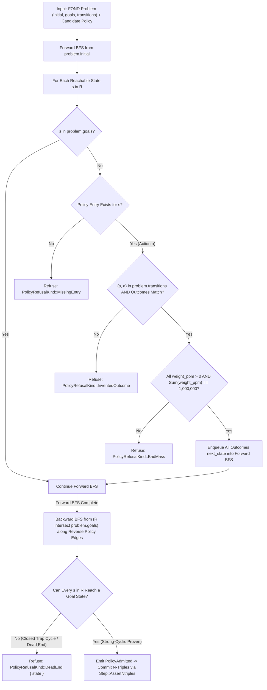

---

## 11. Chapter 11: Cryptographic Attestation, Recursive Receipt Feedback & Out-of-Subject Replay

### 11.1 Deterministic Ed25519 Attestation (`src/attest.rs`)

A BLAKE3 hash proves *what* state transition occurred; an Ed25519 signature proves *who* held the authority to execute or grant it. [`src/attest.rs`](file:///Users/sac/graphlaw/src/attest.rs) implements RFC 8032 Ed25519 signing and verification (`ed25519-dalek`, `default-features = false`) with zero dependency on system CSPRNGs (`getrandom` is never linked).

- **Deterministic Key Derivation ([`SigningKey::from_seed`](file:///Users/sac/graphlaw/src/attest.rs#L48-L55)):** Keys are constructed purely from a 32-byte seed, making key operations reproducible inside `wasm32-wasip1`.
- **Content-Addressed Key Identity ([`VerifyingKey::key_id`](file:///Users/sac/graphlaw/src/attest.rs#L79-L83)):** Every public key is identified by $\text{key\_id} = \mathrm{BLAKE3}(\text{pubkey}_{32})$.
- **Canonical Payload Serialization ([`receipt_signing_payload`](file:///Users/sac/graphlaw/src/attest.rs#L172-L185) & [`lease_signing_payload`](file:///Users/sac/graphlaw/src/attest.rs#L220-L232)):** Signatures are computed over canonical, alphabetically sorted JSON objects (`ceiling`, `child`, `consequence`, `parent`, `step_hash` for receipts; `ceiling`, `expires_epoch_s`, `holder`, `subject` for leases).
- **Multi-Issuer Trust Anchors ([`TrustedKeys`](file:///Users/sac/graphlaw/src/attest.rs#L94-L120)):** Verifies a [`SignedReceipt`](file:///Users/sac/graphlaw/src/attest.rs#L126-L133) or [`SignedLease`](file:///Users/sac/graphlaw/src/attest.rs#L139-L146) by looking up `signer_key_id` in a `BTreeMap<Hash, VerifyingKey>` and checking the 64-byte signature in constant time.

### 11.2 Recursive Receipt Feedback ($R_t \to O^*_{t+1}$, `src/receipt.rs`)

Recall the recursive autonomy law from Chapter 1:
$$
O^*_{t+1} = \mathrm{admit}(\mathrm{observe}(\text{world after } A_t) \cup R_t)
$$
[`src/receipt.rs`](file:///Users/sac/graphlaw/src/receipt.rs) materializes this feedback edge via [`record`](file:///Users/sac/graphlaw/src/receipt.rs#L36-L52) and [`record_signed`](file:///Users/sac/graphlaw/src/receipt.rs#L59-L80), which project a `Receipt` (or `SignedReceipt`) into canonical N-Triples under subject `<urn:graphlaw:receipt:<child_hex>>` (`gl:parentState`, `gl:childState`, `gl:stepHash`, `gl:authorityCeiling`, `gl:addedCount`, `gl:removedCount`, plus `gl:signerKeyId` and `gl:signatureEd25519`) and assert them into `LawState`. Downstream steps can then call [`require`](file:///Users/sac/graphlaw/src/receipt.rs#L86-L152) or [`require_signed`](file:///Users/sac/graphlaw/src/receipt.rs#L159-L199) to gate execution on the cryptographic presence and Ed25519 validity of a prior step's receipt inside the RDF graph itself.

### 11.3 The Content-Addressed Paradox & Out-of-Subject `ReceiptStore` (`src/receipt_store.rs` & `graphlaw-verify`)

While `receipt::record` embeds receipt triples into the RDF graph for in-graph reasoning, doing so mutates the `MemStore` and therefore advances `state.digest()` from $d_1$ to $d_2$. Consequently, the receipt for the transition $d_0 \to d_1$ cannot record $d_1$ as its own post-embedding state without requiring a cryptographic fixed point $\mathrm{BLAKE3}(x) = x$.

[`src/receipt_store.rs`](file:///Users/sac/graphlaw/src/receipt_store.rs) resolves this **Content-Addressed Self-Reference Paradox** by storing receipts out-of-subject on the filesystem (or content-addressed object store) indexed by `(subject, child_digest)`:
- **Layout:** `<root>/<subject_name>/<child_blake3_hex>.json` and optional `<child_blake3_hex>.sig` (`signer_key_id_hex:signature_hex`).
- **Path Traversal Guard ([`check_subject_name`](file:///Users/sac/graphlaw/src/receipt_store.rs#L83-L95)):** Restricts subject names to `[A-Za-z0-9._-]`.
- **Tamper & Chain Verification ([`ReceiptStore::verify`](file:///Users/sac/graphlaw/src/receipt_store.rs#L194-L237) & [`verify_chain`](file:///Users/sac/graphlaw/src/receipt_store.rs#L244-L280)):** Re- verifies that the filename matches `receipt.child`, verifies the `.sig` file against `TrustedKeys`, and walks the linear hash chain $d_0 \to d_1 \to \dots \to d_k$ verifying `prev.child == curr.parent` at every hop.
- **Offline Third-Party CLI ([`src/bin/graphlaw_verify.rs`](file:///Users/sac/graphlaw/src/bin/graphlaw_verify.rs)):** Allows any external auditor to load a subject Turtle file, compute its live `LawState::digest()`, and verify its complete receipt chain and Ed25519 signatures offline (`exit 0` = `STANDING=ALIVE`, `exit 1` = `STANDING=REFUSED`, `exit 2` = `USAGE_ERROR`).

#### Diagram 18: End-to-End Cryptographic Attestation, In-Graph Feedback & Out-of-Subject Verification

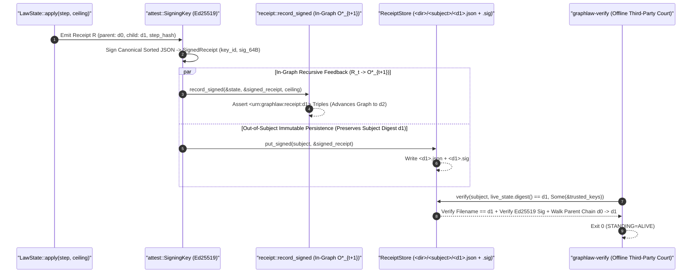

---

## 12. Chapter 12: OCEL Causal Frame Chains & Branchless Denial Polarity Algebra

### 12.1 Cache-Line Aligned `OcelCausalFrame` (`src/receipt_chain/frame.rs`)

For high-frequency process mining and object-centric event log (OCEL 2.0) export, JSON receipts are too verbose. [`src/receipt_chain/frame.rs`](file:///Users/sac/graphlaw/src/receipt_chain/frame.rs) defines [`OcelCausalFrame`](file:///Users/sac/graphlaw/src/receipt_chain/frame.rs#L118-L133), a `#[repr(C, align(64))]` **128-byte** (exact 2 cache-line) binary receipt frame verified at compile time (`const _: () = assert!(size_of::<OcelCausalFrame>() == 128)`):

| Byte Offset | Field | Size | Semantics |
| :--- | :--- | :--- | :--- |
| `0..32` | `prev_hash` | 32 B | Parent frame rolling BLAKE3 digest (`[0u8; 32]` at genesis) |
| `32..64` | `frame_hash` | 32 B | $\mathrm{BLAKE3}(\text{to\_hash\_bytes}())$ over the 99 canonical payload bytes |
| `64..72` | `seq_no` | 8 B | Strictly monotonic sequence number (`prev.seq_no + 1`) |
| `72..80` | `timestamp_ns` | 8 B | Non-decreasing nanosecond timestamp |
| `80..88` | `polarity` | 8 B | [`DenialPolarity`](file:///Users/sac/graphlaw/src/receipt_chain/frame.rs#L35) 8-lane packed guard polarity word |
| `88..120` | `objects` | 32 B | 8 $\times$ [`PackedObjRef`](file:///Users/sac/graphlaw/src/receipt_chain/frame.rs#L13) (`8b type_tag | 24b local_id`, up to 16M objects/type) |
| `120..122` | `event_type` | 2 B | Interned OCEL event activity identifier (`u16`) |
| `122` | `obj_count` | 1 B | Active slots in `objects` (`0..=8`; unused tail slots must be zero) |
| `123..128` | `_pad` | 5 B | Explicit zero padding (`[0u8; 5]`) |

### 12.2 Branchless SWAR `DenialPolarity` Algebra

Traditional rule engines evaluate negated guards (`NOT EXISTS`) via conditional branches, suffering CPU branch-predictor mispredictions on mixed workloads. [`DenialPolarity`](file:///Users/sac/graphlaw/src/receipt_chain/frame.rs#L35-L108) encodes up to **8 concurrent guard lanes** inside a single `u64` word (`8 bytes`), where each lane $i \in \{0..7\}$ holds `[polarity: 1b | reserved: 3b | witness_count: 4b]`:
- **Assertive Lane (`polarity = 0`):** Guard fires iff `witness_count > 0` (`count != 0`).
- **Denial / Absence Lane (`polarity = 1`):** Guard fires iff `witness_count == 0` (`!count_nonzero`).

[`DenialPolarity::to_fired_mask`](file:///Users/sac/graphlaw/src/receipt_chain/frame.rs#L74-L98) evaluates all 8 lanes in parallel using **SWAR (SIMD Within A Register)** bitwise arithmetic with **zero branches**:
```rust
let count_nibbles = self.0 & 0x0F0F_0F0F_0F0F_0F0F;
let pol_bits = (self.0 >> 7) & 0x0101_0101_0101_0101;
let count_nonzero = ((count_nibbles | (count_nibbles.wrapping_add(0x7F7F_7F7F_7F7F_7F7F))) >> 7)
    & 0x0101_0101_0101_0101;
let fired_lanes = count_nonzero ^ pol_bits;
```
The XOR (`count_nonzero ^ pol_bits`) unifies positive and negative guard semantics into a single instruction, and a multiplication-scatter (`wrapping_mul(0x0102_0408_1020_4080) >> 56`) packs all 8 lane verdicts into a single `u8` bitmask. [`ReceiptValidator`](file:///Users/sac/graphlaw/src/receipt_chain/validator.rs) and [`src/bin/graphlaw_ocel_export.rs`](file:///Users/sac/graphlaw/src/bin/graphlaw_ocel_export.rs) verify chains of `OcelCausalFrame`s and project them into W3C OCEL 2.0 JSON logs.

#### Diagram 19: The 128-Byte `OcelCausalFrame` & Branchless SWAR `DenialPolarity` Pipeline

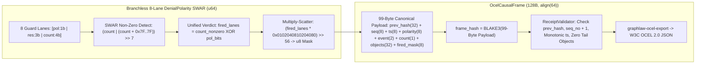

---

## 13. Chapter 13: The 14+1 JSON ABI Dispatcher, Capability Registry & `abi_manifest` Pinning

### 13.1 The 14+1 JSON ABI Dispatcher (`src/abi.rs` & `src/abi/ops/`)

Every host-to-WASM call through `gl_call` (and every native envelope call) routes through [`abi::invoke`](file:///Users/sac/graphlaw/src/abi.rs#L223-L254). Before invoking `serde_json::from_slice`, `invoke` enforces three pre-parse admission guards:
1. **`MAX_INPUT_BYTES = 16 MiB`** ([`src/abi.rs:28`](file:///Users/sac/graphlaw/src/abi.rs#L28)): Rejects oversized envelopes with `QuotaExceeded`.
2. **Non-Allocating Stack Depth Scanner ([`json_depth`](file:///Users/sac/graphlaw/src/abi.rs#L121-L153)):** Scans raw UTF-8 bytes in a single pass—ignoring `{` and `[` inside string literals and handling `\"` escapes—and refuses envelopes exceeding `MAX_JSON_DEPTH = 64` ([`src/abi.rs:32`](file:///Users/sac/graphlaw/src/abi.rs#L32)) *before* `serde_json` allocates a single heap node.
3. **Offline Lease Verification ([`src/abi/lease.rs`](file:///Users/sac/graphlaw/src/abi/lease.rs)):** When an envelope carries a `lease` (`SignedLease`), `verify_envelope_lease` checks that `lease.ceiling >= requested_ceiling`, `now_epoch_s <= lease.expires_epoch_s` (`LeaseExpired`), and the Ed25519 signature validates against `issuer_pubkey_hex` (`LeaseUntrusted`).

Once admitted, `dispatch` routes across **5 modular handler families** covering all 15 operations:
- [`src/abi/ops/meta.rs`](file:///Users/sac/graphlaw/src/abi/ops/meta.rs): `version` (0), `capabilities` (10).
- [`src/abi/ops/parse_convert.rs`](file:///Users/sac/graphlaw/src/abi/ops/parse_convert.rs): `parse` (1), `convert` (2), `canonicalize` (3), `sniff_dialect` (11), `tier_check` (12).
- [`src/abi/ops/query_engines.rs`](file:///Users/sac/graphlaw/src/abi/ops/query_engines.rs): `sparql` (4), `shacl` (5), `n3` (6), `owl_rl` (7), `eval_sql_ast` (13).
- [`src/abi/ops/governance.rs`](file:///Users/sac/graphlaw/src/abi/ops/governance.rs): `step` (8), `hooks` (9), `admit_policy` (14).
- [`src/duckdb_op.rs`](file:///Users/sac/graphlaw/src/duckdb_op.rs): `duckdb` (15 — stateful session sub-ops `open | exec | stream | close`).

#### Diagram 20: The 14+1 JSON ABI Pre-Parse Guards & Modular Dispatch Tree

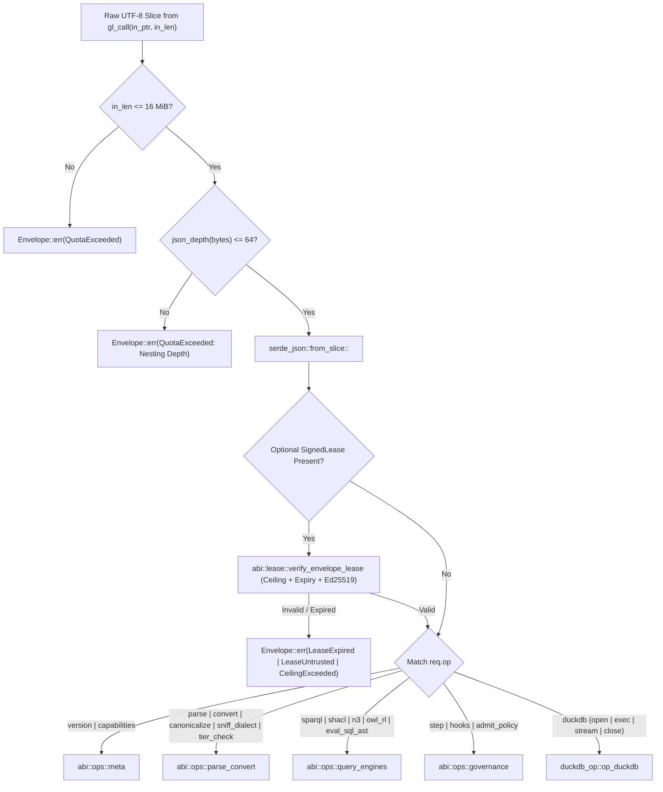

### 13.2 Self-Hashing Capability Registry (`src/registry/`) & `abi_manifest` Pinning (`src/abi_manifest.rs`)

To prevent documentation and FFI drift across host languages (Elixir `wasmex`, Rust `wasmtime`, C/C++), GraphLaw maintains two self-hashing registries:
1. **Capability Registry ([`src/registry/mod.rs`](file:///Users/sac/graphlaw/src/registry/mod.rs), [`definitions.rs`](file:///Users/sac/graphlaw/src/registry/definitions.rs), [`emit_json.rs`](file:///Users/sac/graphlaw/src/registry/emit_json.rs), [`emit_ttl.rs`](file:///Users/sac/graphlaw/src/registry/emit_ttl.rs)):**
   Enumerates all ABI ops, ceilings, error codes, resource limits, and RDF formats. Both JSON and Turtle emitters are custom, dependency-free, float-free ASCII serializers that embed two BLAKE3 digests:
   - [`surface_blake3()`](file:///Users/sac/graphlaw/src/registry/mod.rs#L118-L163): Hashes only the wire-visible ABI contract (names, ceilings, limits, error codes), remaining invariant across prose summary edits.
   - [`registry_blake3()`](file:///Users/sac/graphlaw/src/registry/mod.rs#L168-L176): Hashes the entire canonical JSON document (with the `registry_blake3` field zeroed to 64 `'0'` chars before hashing).
   [`src/bin/graphlaw_registry.rs`](file:///Users/sac/graphlaw/src/bin/graphlaw_registry.rs) (`--check` / `--write`) verifies that `registry/capability-registry.json` and `registry/capability-registry.ttl` match the compiled binary byte-for-byte.
2. **ABI Manifest Pinning ([`src/abi_manifest.rs`](file:///Users/sac/graphlaw/src/abi_manifest.rs)):**
   Embeds [`contracts/abi-manifest.json`](file:///Users/sac/graphlaw/contracts/abi-manifest.json) via `include_str!` and exposes [`verify_matches_live_abi()`](file:///Users/sac/graphlaw/src/abi_manifest.rs#L96-L157), verifying that the manifest's `op_count` (`15`), `ops` list (`op_id`, `op_name`, `authority_ceiling`, `input_cap_bytes`, `timeout_ms`), and `error_codes` (`14` codes) match the live Rust dispatch table.

#### Diagram 21: Dual-Digest Capability Registry & `abi_manifest` Pinning Architecture

```mermaid
flowchart LR
    Defs["Static Definitions (src/registry/definitions.rs)"] --> SurfaceHash["surface_blake3(): Hashes Wire Contract Only (Immune to Doc Edits)"]
    Defs --> EmitJSON["emit_json(): Zero-Placeholder Hash -> registry_blake3()"]
    Defs --> EmitTTL["emit_ttl(): Deterministic ASCII Turtle Projection"]
    EmitJSON --> RegFiles["registry/capability-registry.json + .ttl (Verified by graphlaw-registry --check)"]
    EmitTTL --> RegFiles
    LiveABI["Live Dispatch Table (abi::ABI_OPS + abi::ErrorCode)"] --> PinCheck["abi_manifest::verify_matches_live_abi()"]
    ContractJSON["contracts/abi-manifest.json (include_str!)"] --> PinCheck
```

---

## 14. Chapter 14: Dual-Tier Sandbox Runners & WASI Clock Patch Governance

### 14.1 Dual-Tier Sandbox Runners (`graphlaw-run-eh` & `graphlaw-run`)

To execute `priv/graphlaw.wasm` under strict resource isolation from Elixir/BEAM or CLI pipelines without linking Wasmtime directly into the caller's address space, GraphLaw provides two dedicated out-of-process stdio runners:
1. **Tier A Primary Runner ([`src/bin/graphlaw_run_eh.rs`](file:///Users/sac/graphlaw/src/bin/graphlaw_run_eh.rs)):**
   Hosts the unified W3C Exception-Handling (`try_table` / `exnref`) `priv/graphlaw.wasm` module inside **Wasmtime 48** (`Config::wasm_exceptions(true)`).
2. **Tier B Interpreter Fallback ([`src/bin/graphlaw_run.rs`](file:///Users/sac/graphlaw/src/bin/graphlaw_run.rs)):**
   Hosts the pure-Rust core inside **Wasmi 2.0** when JIT compilation is unavailable or prohibited.

Both runners enforce identical framing, memory walls, and exit-code contracts:
- **Dual Input Modes:** Supports `--packet4` (BEAM `Port.open([:binary, {:packet, 4}])` 4-byte big-endian length-prefixed framing) and `--raw` (stdin-to-EOF, auto-unwrapping Smalt `{"op":"eval","code":"<base64>"}` envelopes via [`unwrap_eval_envelope`](file:///Users/sac/graphlaw/src/bin/graphlaw_run_eh.rs#L254-L303)).
- **Hard Memory & Epoch Walls:** `WALL_BYTES = 64 MiB` (`StoreLimitsBuilder::new().memory_size(64 * 1024 * 1024).trap_on_grow_failure(true)`), `MAX_ENVELOPE = 16 MiB`, and a background epoch-ticker thread that increments the Wasmtime engine epoch every `10 ms` to preempt runaway loops with `exit 84` (`TIMEOUT`).
- **Typed Process Exit Codes:**

| Exit Code | Constant | Meaning |
| :--- | :--- | :--- |
| `0` | `OK` | Valid response envelope written to stdout |
| `2` | `USAGE` | CLI argument or flag error |
| `84` | `TIMEOUT` | Wasmtime epoch deadline exceeded |
| `86` | `MEMORY` | Guest exceeded `64 MiB` linear memory wall or trap |
| `90..97` | `LOAD_ERR..BAD_UTF8` | Guest load, instantiate, alloc, call, framing, or UTF-8 failure |

#### Diagram 22: The `graphlaw-run-eh` Sandbox Lifecycle & Typed Exit Code Automaton

```mermaid
stateDiagram-v2
    [*] --> ReadInput: Parse Args (--wasm, --timeout-ms, --packet4 | --raw)
    ReadInput --> Exit95: Frame > 16 MiB (EXIT_FRAME_ERR = 95)
    ReadInput --> Exit96: Bad Smalt Base64 Envelope (EXIT_BAD_ENVELOPE = 96)
    ReadInput --> InitWasmtime: Payload Extracted
    InitWasmtime --> SpawnEpoch: Enable wasm_exceptions(true) + 64 MiB Memory Wall (trap_on_grow_failure)
    SpawnEpoch --> GuestAlloc: gl_alloc(payload.len())
    GuestAlloc --> Exit92: ptr <= 0 (EXIT_ALLOC_ERR = 92)
    GuestAlloc --> GuestCall: Write Bytes -> gl_call(in_ptr, in_len, out_ptr, out_len)
    GuestCall --> Exit84: Epoch Deadline Reached (EXIT_TIMEOUT = 84)
    GuestCall --> Exit86: Memory > 64 MiB Trap (EXIT_MEMORY = 86)
    GuestCall --> ReadOut: Read Guest Response + gl_free(in_ptr) + gl_free(out_ptr)
    ReadOut --> WriteStdout: Valid UTF-8 Envelope -> Write Raw or Packet-4 to Stdout
    WriteStdout --> [*]: Exit 0
```

### 14.2 WASI Clock Gate Provenance (`seanchatmangpt/purrdf`)

Upstream `purrdf-sparql-eval` once compiled `NOW()` on `target_arch = "wasm32"` by calling `js_sys::Date::new_0()`, which imports browser JavaScript symbols that do not exist in `wasm32-wasip1` and traps on WASI runtimes. The fix — gating the browser-only clock/RNG paths on `all(target_arch = "wasm32", target_os = "unknown")` so WASI keeps the real std clock — lives in the purrdf fork ([seanchatmangpt/purrdf](https://github.com/seanchatmangpt/purrdf)) at the rev pinned in `Cargo.toml`. Nothing is patched: the pinned sources build for WASM as they are. The artifact carries exactly 28 imports, all `wasi_snapshot_preview1` — zero browser/host imports.

The provenance court is the pin itself: `Cargo.toml` rev-pins the fork, `deny.toml` allows that URL as its only git source, and CI's provenance step refuses any purrdf-family package resolving from anything else. Bumping the pin is a reviewed diff (dependabot ignores `purrdf*`; bumps are deliberate rev changes).

#### Diagram 23: Pinned-fork WASI gate provenance

```mermaid
flowchart LR
    CargoBuild["cargo build (Host or wasm32-wasip1)"] --> Resolve["Cargo resolves purrdf* from git+seanchatmangpt/purrdf?rev=<pin>"]
    Resolve --> Fork["fork rev carries the all(wasm32, unknown) clock gate"]
    Fork --> Compile["Build WASM directly — no patch machinery"]
```

---

## 15. Chapter 15: The `purrdf-n3` Notation3 Engine (git-sourced), $\mathcal{EL}$ Dual-Route Verification & Formal AI Vector Oracles

### 15.1 The `purrdf-n3 3.0.1` Notation3 Reasoner (purrdf crates/n3)

For full Notation3 (`N3`) forward/backward chaining with scoped negation-as-failure (`log:notIncludes`, `log:collectAllIn`), arithmetic (`math:*`), string/list builtins, and formal proof emission (`r:Inference`, `r:Extraction`, `r:Parsing`), GraphLaw consumes `purrdf-n3 3.0.1` — purrdf's own native Notation3 crate (`purrdf` crates/n3 @ 3.0.1), MIT/Apache-2.0/no-claim/MulanPSL-2.0 licensed — from the pinned [seanchatmangpt/purrdf](https://github.com/seanchatmangpt/purrdf) fork. GraphLaw consumes it through the stable `purrdf::n3` re-export (`BACKEND_AUTHORITIES` Notation3 authority `purrdf::n3`, revision `3.0.1`, [`src/lib.rs`](file:///Users/sac/graphlaw/src/lib.rs)); the engine was originally derived from the eyeron codebase (Jos De Roo) and was subsequently upstreamed into purrdf as its native `n3` crate — that derivation is lineage history, not current structure.

The crate is organized into a clean 6-stage deterministic pipeline over the fork's `crates/n3/src/`:
1. **Lexer & N3 Parser (`lexer.rs`, `parser.rs`, `rdf_compat.rs`):** Parses N3 syntax (`{ ... } => { ... }`, `@forAll`, `@forSome`, paths, lists) or RDF message logs (`parse_rdf_message_log` / `is_rdf_message_log`, re-exported from `parser.rs`) into an `ast::Document`.
2. **Terms, Prefixes & Quoted Graphs (`ast.rs`):** Models IRIs, blank nodes, literals, and quoted formula graphs (`Term::Formula(Graph)`) together with prefix bindings for the whole document.
3. **Unification & Matching (`reasoner.rs`):** Substitutes variable bindings across nested formula graphs during forward chaining.
4. **Builtin Evaluation (`reasoner.rs`):** Evaluates `log:*`, `math:*`, `string:*`, `list:*`, `time:*`, and `crypto:*` predicates deterministically (with runtime timestamps neutralized for reproducible WASM execution).
5. **Prepared Reasoner (`reasoner.rs`):** `PreparedReasoner::new(program: Document)` compiles a parsed document once (forward-agenda index built in the constructor) so a TBox/ruleset can be prepared once and reused across thousands of ABox invocations (`PreparedReasoner::reason(data, options)`).
6. **Formal Proof Writer & Independent Proof Checker (`proof_writer.rs`, `proof_check.rs`, `proof_check_n3.rs`):** Emits W3C `reason:` (`http://www.w3.org/2000/10/swap/reason#`) proof graphs and verifies them via `proof_check_n3`, checking that every `r:Inference` step validly instantiates its rule's antecedent and consequent.

#### Diagram 24: The `purrdf-n3` Notation3 Reasoning & Formal Proof Verification Pipeline

```mermaid
flowchart TD
    N3Source["N3 Source / RDF Message Log"] --> Parser["lexer.rs + parser.rs -> ast::Document"]
    Parser --> Prepare["PreparedReasoner::new(doc) -> PreparedReasoner (Reusable TBox)"]
    Prepare --> Run["reasoner.rs: Forward Chaining + Scoped Closure + Builtin Evaluation (log/math/string/list/time/crypto)"]
    Run --> Mode{"ReasonerOptions.proof?"}
    Mode -->|"false (Deductive Closure)"| Closure["Emit Derived N3 Facts / Conclusions"]
    Mode -->|"true (Formal Proof Trace)"| ProofWriter["proof_writer.rs: Emit W3C swap/reason# Proof Graph (r:Proof, r:Inference, r:binding)"]
    ProofWriter --> ProofCheck["proof_check_n3(): Independently Re-Verify Every Inference Step"]
```

The fork ships its N3 court suite
(`crates/n3/tests/`: `n3_parse.rs`, `n3_reason.rs`, `n3_proofs.rs`, `n3_forgery.rs`;
`harness = false`, executed in fork CI at the pinned rev), which pins the
advertised quantifier surface
(`@forAll`/`@forSome` positive parse courts), the single strict langtag
grammar shared by both profiles (audit C8/F8: a malformed langtag refuses
and case-folds on N3 too), and stage 6's proof pipeline end-to-end
(derive → `proof_to_n3` → `check_proof` round-trip in `n3_proofs.rs`);
parity receipt 2026-10-26: 72 passed / 0 failed (`vendor/README.md`).

### 15.2 Description Logic $\mathcal{EL}$ Dual-Route Verification (`src/bin/dl_dualroute.rs`) & The 7 AI Vector Oracles (`examples/*`)

How do we verify that two independent reasoning engines inside the kernel agree on ontological subsumption ($C \sqsubseteq D$)? [`src/bin/dl_dualroute.rs`](file:///Users/sac/graphlaw/src/bin/dl_dualroute.rs) implements a **Dual-Route Description Logic $\mathcal{EL}$ TBox Subsumption Verifier** over a 25-concept biomedical ontology (17 atomic concepts including `Appendicitis`, `Endocarditis`, `HeartValve`, `Perforation` + 8 intermediate reified intersections) and 10 ground subsumption queries (`5 ENTAILED`, `5 NOT_ENTAILED`):

- **Route A — Explicit $\mathcal{EL}$ Classification via N3 Datalog Rules (`ABI op="n3"`):**
  Encodes the four Baader-Brandt-Lutz (2005) polynomial-time $\mathcal{EL}$ completion rules (`CR1` reflexivity, `CR2` transitivity, `CR3` conjunction introduction, `CR4` existential lifting) in 12 lines of N3 ([`EL_META_N3`](file:///Users/sac/graphlaw/src/bin/dl_dualroute.rs#L172-L195)) and checks if `C rdfs:subClassOf D` is derived.
- **Route B — Canonical Witness Individual Reduction via OWL 2 RL (`ABI op="owl_rl"`):**
  Because standard W3C OWL 2 RL (`cls-hv1`/`cls-hv2` + `scm-hv`) omits pure TBox existential-to-existential lifting (`CR4`), `dl_dualroute` injects a fresh canonical witness individual $w_C : C$ into the ABox along with per-existential Skolem filler rules (`?x a :HasLocHeart => ?x :hasLocation :_w_Heart`), runs `op="owl_rl"`, and checks if $w_C : D$ is materialized.
- **Cross-Engine Agreement:** Both routes execute through `graphlaw::abi::invoke`, produce `10/10` exact agreement with the analytical oracle (`dl_dualroute: 10/10 queries agree across Route A (N3 EL) and Route B (OWL-RL witness) — PASS`), and chain all 20 ABI transitions into a verified `LawState` receipt lineage.

Complementing `dl_dualroute`, [`examples/`](file:///Users/sac/graphlaw/examples/) contains **7 self-contained formal AI verification binaries** (`pddl_blocks_world`, `fond_tireworld`, `allen_interval_algebra`, `rcc8_spatial`, `deontic_privacy`, `dung_argumentation`, `socrates_mortality`), each pairing an N3/OWL-RL deductive route against an independent Rust matrix/fixpoint oracle and verifying receipt chaining.

#### Diagram 25: The `dl_dualroute` Description Logic $\mathcal{EL}$ Cross-Engine Verification Court

```mermaid
flowchart LR
    TBox["Biomedical EL TBox (25 Concepts) + Query (C SubClassOf D?)"] --> RouteA["Route A: ABI op='n3' + Baader-Brandt-Lutz CR1..CR4 N3 Rules"]
    TBox --> RouteB["Route B: ABI op='owl_rl' + Canonical Witness Individual (w_C : C) + Skolem Fillers"]
    RouteA --> VerdictA["Check: (C rdfs:subClassOf D) in N3 Closure"]
    RouteB --> VerdictB["Check: (w_C rdf:type D) in OWL-RL Closure"]
    VerdictA --> Court{"VerdictA == VerdictB == Ground Oracle (10/10)?"}
    VerdictB --> Court
    Court -->|"Yes"| Chain["Commit 20-Step LawState Receipt Chain -> PASS"]
```

---

## 16. Chapter 16: Self-Monitoring Pack, SA2A Semantic Evidence Courts, FIBO Banking Suite & The 27-Subsystem Master Matrix

### 16.1 Self-Monitoring Pack (`src/smon.rs`, `smon_transcript_to_turtle`, `smon_broaden_topic`)

To close the loop on agentic self-observation (`C16: agent behavior conformance`), [`src/smon.rs`](file:///Users/sac/graphlaw/src/smon.rs) implements the **Self-Monitoring Pack (`smon:`)** deterministic transcript-to-RDF extractor and counterfactual replay court:
1. **Deterministic Turn Classification ([`classify_turns`](file:///Users/sac/graphlaw/src/smon.rs#L118-L214)):**
   Parses raw JSONL conversation transcripts (`role`, `text`) using compiled regex patterns (`LazyLock<Regex>`) to classify turns into `smon:UserCorrection` (e.g., *"why didn't you"*, *"no, I meant"*), `smon:ToolFailure` (e.g., `Exit code [1-9]`), `smon:TopicTag` (`git`, `compile_error`, `hook`, `test`, `rdf_ontology`, `file_edit`), and `smon:RuleProposal` (`smon:confidence`, `smon:scope`, `smon:addressesTurn`).
2. **SHACL Admission & N3 Promotion (`evaluate_session`):**
   Validates the extracted session graph against `shapes.ttl` (`smon:RuleProposalShape` requiring confidence $\in [0.0, 1.0]$, valid scope, and linked turn) and runs `rules.n3` to derive `smon:PromotableRule`, `smon:RepeatedCorrectionTopic`, and `smon:UnaddressedFailure` inside a `LawState::apply` transition.
3. **Counterfactual Policy Replay ([`src/bin/smon_broaden_topic.rs`](file:///Users/sac/graphlaw/src/bin/smon_broaden_topic.rs)):**
   Replays real transcripts (`1,575 turns`) after broadening a single topic regex in `src/smon.rs`, proving that every changed `smon:PromotableRule` derivation is causally explained by the new topic tag while producing a fresh `LawState` BLAKE3 receipt.

#### Diagram 26: The `smon` Transcript-to-Turtle Extraction & Counterfactual Replay Pipeline

```mermaid
flowchart TD
    JSONL["Raw Agent Transcript (.jsonl)"] --> Extract["smon::transcript_to_turtle: Regex Turn Classifier (UserCorrection, ToolFailure, TopicTag, RuleProposal)"]
    Extract --> SHACL["SHACL Gate: smon:RuleProposalShape (Confidence, Scope, Linked Turn)"]
    SHACL --> N3Rules["N3 Rules (rules.n3): Derive smon:PromotableRule + smon:RepeatedCorrectionTopic"]
    N3Rules --> LawApply["LawState::apply(Step::AssertNtriples) -> BLAKE3 Receipt"]
    LawApply --> Broaden["smon-broaden-topic: Counterfactual Topic Regex Widening -> Causal Diff Verification"]
```

### 16.2 SA2A Semantic Evidence Courts (`sa2a_run14_verify`, `sa2a_portability_verify`) & FIBO Banking Suite

Finally, GraphLaw serves as the zero-authority semantic verifier for the **Semantic A2A (`sa2a`)** and **FIBO (Financial Industry Business Ontology)** regulatory compliance suites:
1. **SA2A Run12/Run14 Semantic Evidence Court ([`src/bin/sa2a_run14_verify.rs`](file:///Users/sac/graphlaw/src/bin/sa2a_run14_verify.rs)):**
   Executes 7 deterministic courts (`C1` SHACL schema admissibility on 20 agent cards, `C2` SHACL violation refusal on 4 malformed cards, `C3` OWL 2 RL capability hierarchy closure, `C4` N3 structural admissibility rules, `C5` SPARQL capability routing & negative guard, `C6` Run14 execution trace verification over 10 tasks / 30 steps / 4 faults, and `C7` `LawState` cryptographic receipt chain) with **zero authority** (`Ceiling::Construct` max; `Ceiling::Do` is structurally absent).
2. **SA2A Portability Court ([`src/bin/sa2a_portability_verify.rs`](file:///Users/sac/graphlaw/src/bin/sa2a_portability_verify.rs)):**
   Verifies across 6 courts (`P1..P6`) that 4 distinct agent runtimes (`Alpha/LangGraph`, `Beta/AutoGen`, `Gamma/CrewAI`, `Delta/SemanticKernel`) projecting into the shared `sa2a:` + `prov:` ontology are governed by the exact same SHACL shapes, N3 handoff rules, and SPARQL lineage queries with zero runtime-specific branches.
3. **FIBO Banking Verification Suite ([`tests/fibo_banking_suite.rs`](file:///Users/sac/graphlaw/tests/fibo_banking_suite.rs)):**
   Runs 4 financial regulatory courts over real OMG FIBO ontology modules (`Metadata`, `Loan`, `Account`, `CurrencyAmount`):
   - **Court 1 (`fibo_court1_tbox_hierarchy_closure`):** Materializes multi-hop `rdfs:subClassOf` chains (`Mortgage` $\sqsubseteq$ `Loan` $\sqsubseteq$ `CreditAgreement` $\sqsubseteq$ `WrittenContract`) via OWL 2 RL.
   - **Court 2 (`fibo_court2_basel_ltv_classification_and_inconsistency`):** Evaluates Basel III Loan-to-Value (`LTV`) risk weights via N3 math builtins (`LTV <= 0.80` $\to$ `35%` weight; `LTV > 0.80` $\to$ `75%` High-LTV weight) and detects `owl:Nothing` inconsistency when a loan violates its product class ceiling.
   - **Court 3 (`fibo_court3_aml_structuring_smurfing_detection`):** Combines `owl_rl` (resolving `owl:sameAs` Beneficial Owner aliases across shell LLCs) with `n3` (`log:collectAllIn` + `math:sum`) to detect CTR structuring ("smurfing") when split cash deposits aggregate above `$10,000`.
   - **Court 4 (`fibo_court4_knowledge_hook_sanctions_fuse`):** Fires a priority-ordered `kh:Hook` (`kh:EmitDelta` $\to$ `kh:Refuse` sanctions fuse) that halts wire execution and preserves the pre-wire `LawState` untouched when an OFAC-sanctioned entity (`SDN-9981`) is detected.

#### Diagram 27: The SA2A Run12/Run14 & Cross-Runtime Portability Verification Architecture

```mermaid
flowchart LR
    subgraph Run14["sa2a_run14_verify (7 Zero-Authority Courts)"]
        C1C2["C1/C2: SHACL Admissibility (20 Valid Pass, 4 Malformed Refused)"]
        C3C4["C3/C4: OWL 2 RL Capability Hierarchy + N3 Admissibility"]
        C5C6["C5/C6: SPARQL Routing + 30-Step Trace & Fault Recovery"]
        C7["C7: 4-Stage LawState BLAKE3 Receipt Lineage"]
        C1C2 --> C3C4 --> C5C6 --> C7
    end

    subgraph Portability["sa2a_portability_verify (4 Heterogeneous Runtimes)"]
        Runtimes["LangGraph (Python) + AutoGen (.NET) + CrewAI + SemanticKernel"]
        Shared["Shared sa2a: + prov: RDF Graph"]
        P1P6["P1..P6: Uniform SHACL + N3 Cross-Runtime Handoff + SPARQL Lineage"]
        Runtimes --> Shared --> P1P6
    end
```

#### Diagram 28: The FIBO 4-Court Banking & AML/Sanctions Verification Suite

```mermaid
flowchart TD
    FIBO["Real OMG FIBO Modules (Loan, Account, Relations, CurrencyAmount)"] --> Court1["Court 1 (OWL 2 RL): Multi-Hop TBox SubClassOf Closure (Mortgage -> WrittenContract)"]
    FIBO --> Court2["Court 2 (N3 + OWL-RL): Basel III LTV Risk Weighting (35% vs 75%) + owl:Nothing Inconsistency Trap"]
    FIBO --> Court3["Court 3 (OWL-RL owl:sameAs + N3 math:sum): Beneficial Owner Entity Resolution + $10,000 CTR Smurfing Detection"]
    FIBO --> Court4["Court 4 (kh:Hook Priority Cascade): Sanctions Fuse (SDN-9981) -> HookOutcome::Refused (LawState Preserved)"]
```

---

### 16.3 Complete 27-Subsystem Master Architectural Matrix

Every subsystem in `/Users/sac/graphlaw` is cataloged below with its locus, thesis chapter, Mermaid diagram(s), and verified epistemic standing at commit `c6a1939f462de3287b94069f96eaf27ad877fb1f`:

| # | Subsystem | Primary Source Locus | Chapter | Diagram(s) | Epistemic Standing |
| :--- | :--- | :--- | :--- | :--- | :--- |
| **1** | Epistemic State Machine (`LawState`, `Step`, `Ceiling`, `Lease`) | [`src/law.rs`](file:///Users/sac/graphlaw/src/law.rs) | Ch. 1, 2 | Diag. 1, 3 | `ALIVE` |
| **2** | 14-Dialect Content Sniffer (`sniff`, `Ambiguous` Refusal) | [`src/dialect/mod.rs`](file:///Users/sac/graphlaw/src/dialect/mod.rs) | Ch. 2.2 | Diag. 2 | `ALIVE` |
| **3** | 3-Tier Execution Lattice (`Rdf`, `N3Logic`, `Relational`) | [`src/tier.rs`](file:///Users/sac/graphlaw/src/tier.rs) | Ch. 2.2 | Diag. 2 | `ALIVE` |
| **4** | Pre-Admission SHACL Depth Guard (`check_shape_depth`) | [`src/shacl_guard.rs`](file:///Users/sac/graphlaw/src/shacl_guard.rs) | Ch. 2.2 | Diag. 2 | `ALIVE` |
| **5** | SQL-in-RDF Ontology & 35 DuckDB 2.0 Statement Classes | [`ontologies/sql-ast.ttl`](file:///Users/sac/graphlaw/ontologies/sql-ast.ttl), [`src/sql_statement_kinds.rs`](file:///Users/sac/graphlaw/src/sql_statement_kinds.rs) | Ch. 3 | Diag. 4 | `ALIVE` |
| **6** | SQL-in-RDF Compiler, `ScopePos` Lattice, `admission_seal` & `REFUSAL-01..05` | [`src/sql_ast.rs`](file:///Users/sac/graphlaw/src/sql_ast.rs), [`src/sql_ast/`](file:///Users/sac/graphlaw/src/sql_ast/ast.rs) | Ch. 4 | Diag. 5, 6 | `ALIVE` |
| **7** | Unified `wasm32-wasip1` C-ABI Reactor, `LIVE` Side-Table & W3C-EH | [`wasm/src/lib.rs`](file:///Users/sac/graphlaw/wasm/src/lib.rs), [`wasm/src/ffi.rs`](file:///Users/sac/graphlaw/wasm/src/ffi.rs) | Ch. 5 | Diag. 7, 8 | `ALIVE` |
| **8** | Two-Node BLAKE3 `duckdb_eval` & Multi-Statement Batch Evaluator | [`src/duckdb_eval.rs`](file:///Users/sac/graphlaw/src/duckdb_eval.rs) | Ch. 6.1, 6.2 | Diag. 9, 10 | `ALIVE` |
| **9** | Stateful Op-15 Session Manager (`open`, `exec`, `stream`, `close`) | [`src/duckdb_op.rs`](file:///Users/sac/graphlaw/src/duckdb_op.rs) | Ch. 6.3 | Diag. 10 | `ALIVE` |
| **10** | Standing-Addressed `QueryCache` (`C1`, `C1-a` Mutation Gate) | [`src/query_cache.rs`](file:///Users/sac/graphlaw/src/query_cache.rs) | Ch. 6.4 | Diag. 9 | `ALIVE` |
| **11** | Lock-Free SPSC `EvidenceRing` (64B `RingDescriptor`) & `QueryLedger` | [`src/evidence_ring.rs`](file:///Users/sac/graphlaw/src/evidence_ring.rs), [`src/query_ledger/`](file:///Users/sac/graphlaw/src/query_ledger/mod.rs) | Ch. 7.1, 7.2 | Diag. 11 | `ALIVE` |
| **12** | 128B `ArrowEgressHeader` & Clean-Room `graphlaw-reconstituted` | [`src/egress/arrow.rs`](file:///Users/sac/graphlaw/src/egress/arrow.rs), [`crates/graphlaw-reconstituted/`](file:///Users/sac/graphlaw/crates/graphlaw-reconstituted/src/lib.rs) | Ch. 7.3, 8.2 | Diag. 12, 13 | `ALIVE` |
| **13** | Qualification Algebra $Q=(S,C,A,O,P,E,H)$ & Standing Lattice | [`src/qualification.rs`](file:///Users/sac/graphlaw/src/qualification.rs) | Ch. 8.1 | Diag. 13 | `ALIVE` |
| **14** | Stratified `kh:Hook` Fixpoint Engine & Lineage Firing Dedup | [`src/hooks.rs`](file:///Users/sac/graphlaw/src/hooks.rs) | Ch. 9.1 | Diag. 14 | `ALIVE` |
| **15** | Deductive-Relational Rule Builtin (`builtin_eval_sql` / `gl:evalSql`) | [`src/rules/builtins.rs`](file:///Users/sac/graphlaw/src/rules/builtins.rs) | Ch. 9.2 | Diag. 15 | `ALIVE` |
| **16** | Ground Action Plan Replay Verifier (`Plan::admit`) | [`src/plan.rs`](file:///Users/sac/graphlaw/src/plan.rs) | Ch. 10.1 | Diag. 16 | `ALIVE` |
| **17** | FOND Strong-Cyclic Policy Court (`admit_parsed`, `1,000,000` ppm) | [`src/policy.rs`](file:///Users/sac/graphlaw/src/policy.rs) | Ch. 10.2 | Diag. 17 | `ALIVE` |
| **18** | Deterministic Ed25519 Attestation (`SigningKey`, `TrustedKeys`) | [`src/attest.rs`](file:///Users/sac/graphlaw/src/attest.rs), [`src/bin/graphlaw_attest.rs`](file:///Users/sac/graphlaw/src/bin/graphlaw_attest.rs) | Ch. 11.1 | Diag. 18 | `ALIVE` |
| **19** | In-Graph Recursive Receipt Feedback (`receipt::record_signed`) | [`src/receipt.rs`](file:///Users/sac/graphlaw/src/receipt.rs) | Ch. 11.2 | Diag. 18 | `ALIVE` |
| **20** | Out-of-Subject `ReceiptStore` & Offline Replay CLI (`graphlaw-verify`) | [`src/receipt_store.rs`](file:///Users/sac/graphlaw/src/receipt_store.rs), [`src/bin/graphlaw_verify.rs`](file:///Users/sac/graphlaw/src/bin/graphlaw_verify.rs) | Ch. 11.3 | Diag. 18 | `ALIVE` |
| **21** | 128B `OcelCausalFrame` & Branchless SWAR `DenialPolarity` | [`src/receipt_chain/frame.rs`](file:///Users/sac/graphlaw/src/receipt_chain/frame.rs), [`src/bin/graphlaw_ocel_export.rs`](file:///Users/sac/graphlaw/src/bin/graphlaw_ocel_export.rs) | Ch. 12 | Diag. 19 | `ALIVE` |
| **22** | 14+1 JSON ABI Dispatcher (`json_depth`, Lease Check, 5 Op Modules) | [`src/abi.rs`](file:///Users/sac/graphlaw/src/abi.rs), [`src/abi/ops/`](file:///Users/sac/graphlaw/src/abi/ops/mod.rs) | Ch. 13.1 | Diag. 20 | `ALIVE` |
| **23** | Dual-Digest Capability Registry & `abi_manifest` Pinning | [`src/registry/`](file:///Users/sac/graphlaw/src/registry/mod.rs), [`src/abi_manifest.rs`](file:///Users/sac/graphlaw/src/abi_manifest.rs) | Ch. 13.2 | Diag. 21 | `ALIVE` |
| **24** | Out-of-Process Sandbox Runners (`graphlaw-run-eh` & `graphlaw-run`) | [`src/bin/graphlaw_run_eh.rs`](file:///Users/sac/graphlaw/src/bin/graphlaw_run_eh.rs), [`src/bin/graphlaw_run.rs`](file:///Users/sac/graphlaw/src/bin/graphlaw_run.rs) | Ch. 14.1 | Diag. 22 | `ALIVE` |
| **25** | Pinned-fork WASI gate provenance (pin + deny.toml + CI provenance step) | `Cargo.toml`, `deny.toml`, `.github/workflows/ci.yml` | Ch. 14.2 | Diag. 23 | `ALIVE` |
| **26** | The `purrdf-n3` N3 Reasoner (git-sourced, pinned rev), `dl_dualroute` & 7 AI Oracles | [purrdf crates/n3](https://github.com/seanchatmangpt/purrdf/tree/main/crates/n3), [`src/bin/dl_dualroute.rs`](file:///Users/sac/graphlaw/src/bin/dl_dualroute.rs), [`examples/`](file:///Users/sac/graphlaw/examples/) | Ch. 15 | Diag. 24, 25 | `ALIVE` |
| **27** | Self-Monitoring Pack (`smon`), SA2A Evidence Courts & FIBO Suite | [`src/smon.rs`](file:///Users/sac/graphlaw/src/smon.rs), [`src/bin/sa2a_run14_verify.rs`](file:///Users/sac/graphlaw/src/bin/sa2a_run14_verify.rs), [`tests/fibo_banking_suite.rs`](file:///Users/sac/graphlaw/tests/fibo_banking_suite.rs) | Ch. 16 | Diag. 26, 27, 28 | `ALIVE` |

---

### 16.4 Conclusion

Across all 27 subsystems, 16 chapters, and 28 architectural diagrams, GraphLaw demonstrates that high-throughput analytical computing, formal deductive reasoning, automated planning, and cryptographic governance can be unified inside a single deterministic kernel. By replacing the unverified SQL string with a closed-world SHACL-admitted RDF graph (`sql-rdf`), sealing the compiled artifact at admission (`compile_turtle`), linking the complete vectorized `frozen-duckdb` engine directly into a W3C-EH `wasm32-wasip1` reactor (`priv/graphlaw.wasm`), and binding every deductive, planning, policy, hook, and relational transition into a BLAKE3/Ed25519 receipt chain, the system transforms security, replayability, and regulatory compliance from after-the-fact audits into structural invariants of execution.

Where a traditional database or agent runtime asks its caller to *trust* the operator's log, GraphLaw answers every epistemic question with a self-verifying command: **here is the canonical graph, the signed lease, and the BLAKE3 receipt—replay it offline.**
