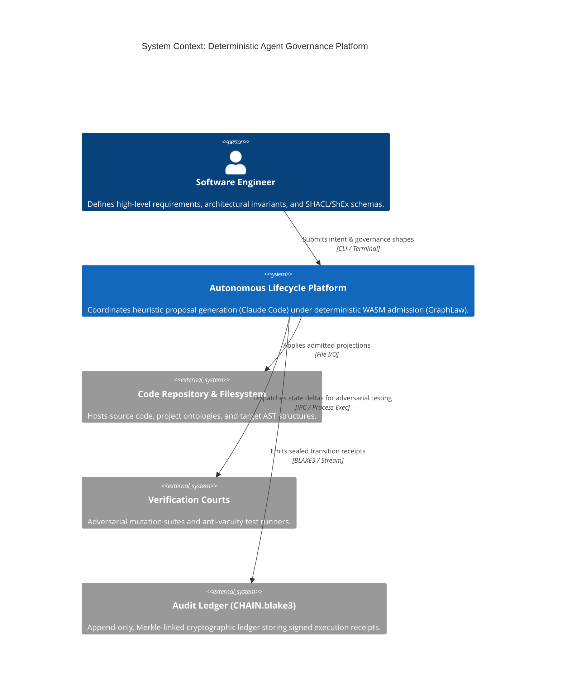
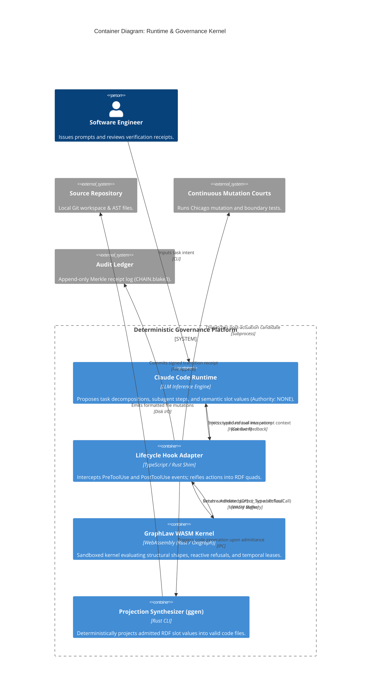
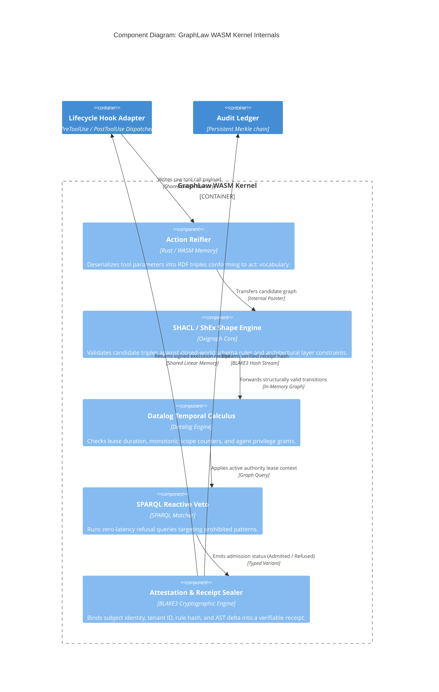

# C4 Architecture Documentation — Deterministic Agent Governance Platform

Filed verbatim (operator text, 2026-10-22). Mapped across Level 1 (System
Context), Level 2 (Container), and Level 3 (Component) models using Mermaid.

## Level 1: System Context Diagram

The System Context diagram illustrates the boundary of the Deterministic
Agent Governance Platform, showing how external actors (engineers),
development assets (repositories), verification environments, and audit
sinks interact with the core engine.

### Context Entities

* **Software Engineer**: Supplies intent and maintains formal constraints
  (ontologies, schemas, policies) rather than writing unconstrained prompts.
* **Autonomous Lifecycle Platform**: The closed-loop system enforcing zero
  unreceipted actuation.
* **Code Repository & Filesystem**: The persistent software baseline modified
  only through admitted AST projections.
* **Verification Courts**: Post-execution environments checking for semantic
  vacuity and test regression before final receipt attestation.
* **Audit Ledger**: The permanent, tamper-evident record establishing
  non-repudiation across all agent iterations.

## Level 2: Container Diagram

The Container diagram decomposes the platform into the agent runtime,
interception hooks, the WASM admission sandbox, code synthesizers, and
persistence layers.

### Container Responsibilities

* **Claude Code Runtime**: Confined to heuristic candidate synthesis ($O$).
  Has zero direct access to OS syscalls, network sockets, or raw disk files.
* **Lifecycle Hook Adapter**: Acts as the boundary gateway. It normalizes
  unstructured agent requests into formal RDF statements before calling the
  kernel.
* **GraphLaw WASM Kernel**: An isolated, zero-leakage micro-kernel. Executes
  all validation logic deterministically in sub-millisecond execution windows.
* **Projection Synthesizer (`ggen`)**: Eliminates free-form string
  concatenation by compiling admitted graph structures directly into
  validated ASTs.

## Level 3: Component Diagram (GraphLaw WASM Kernel)

The Component diagram inspects the internals of the **GraphLaw WASM
Kernel**, isolating how incoming candidate transitions are validated,
governed, and attested.

### Component Workflow

1. **Action Reifier**: Receives raw tool parameters and reifies them into
   standard RDF statements (`act:target`, `act:scope`, `act:tool`,
   `act:agent`).
2. **SHACL / ShEx Shape Engine**: Guarantees architectural compliance (e.g.,
   preventing a controller layer from directly accessing an internal database
   driver).
3. **Datalog Temporal Calculus**: Enforces operational constraints including
   token quota bounds, file lock leases, and monotonic call limits.
4. **SPARQL Reactive Veto**: Evaluates targeted patterns that immediately
   trigger refusal before any computational budget is wasted.
5. **Attestation & Receipt Sealer**: Generates the final cryptographic
   envelope, certifying whether an action was admitted or refused with an
   immutable audit hash.
