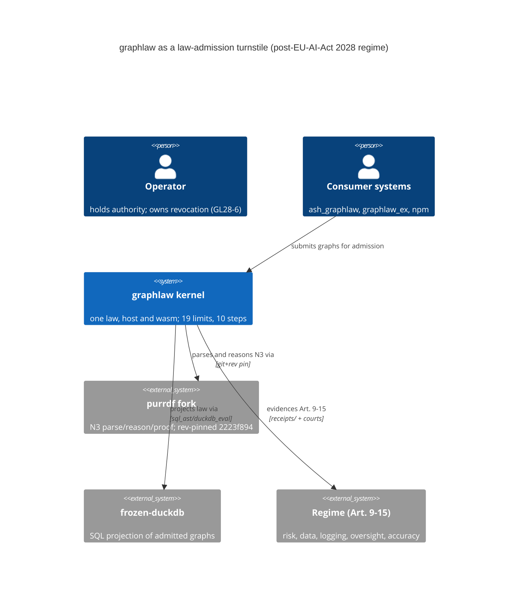

# Vision 2028 — C4 Architecture Model (v26.10.28)

A 4-level C4 model of the graphlaw law-admission turnstile as it stands at
v26.10.28, mapped to the post-EU-AI-Act 2028 regime (Articles 9-15).
Compliance-relevant edges that are drawn but not yet built are marked with
their GL28 backlog reference rather than asserted.

## Facts (re-read from the tree, 2026-10-28)

Full digests (copy from here; each line ≤100):

```
wasm blake3
c38b1fdb97ba462dc96000301d7ddf6a5109a7208c68a52f5ddd63ccbd6fda2c
registry blake3
6e1103673508ade20f2276e93c7c948dd4f7c31689a25a325fac4a308856035d
fork rev
2223f8945e19eb9aed750fe038b0fa833bd17c83
```

- wasm artifact: blake3 `c38b1fdb…` (74,097,211 B) — `registry/ARTIFACTS.blake3:17`
- WASI imports: 28/28 `wasi_snapshot_preview1`, zero host-module imports
  (GO-NO-GO.md:30)
- purrdf fork: `graphlaw-carried` @ `2223f894…` (RECEIPTS.md)
- registry digest: `blake3:6e110367…`
  (`registry/capability-registry.json` `registry_blake3`)
- limit rows: 19; law-steps: 10 (same registry, counted 2026-10-28)
- SPC: Cpk 6.0979 / 14.4149 (gate 1.33), p99 125/118 ns
  (`receipts/spc-2026-10-28T165319.json`, `…T171756.json`)
- wasm size ceiling: 80 MiB (SCAR — carrying cost, slimming OPEN)

## Level 1 — C4 Context



## Level 2 — C4 Container

```mermaid
C4Container
    title graphlaw containers (v26.10.28)
    Person(consumer, "Consumer", "ash_graphlaw / graphlaw_ex / npm")
    Container_B(graphlaw_wasm, "graphlaw-wasm", "wasm32", "ONE law; c38b1fdb; 28/28 wasi imports")
    Container_B(law_kernel, "law kernel", "Rust", "law.rs; sql_ast.rs; duckdb_eval.rs; attest.rs")
    ContainerDb_B(receipts, "receipt surface", "files", "append-only; per-file blake3; Cpk 6.0979")
    ContainerDb_B(registry, "capability registry", "JSON/TTL", "19 limits, 10 law-steps; 6e110367")
    Container_Ext(beam, "graphlaw_ex (BEAM)", "wasmex host; admit+tamper 2/2")
    Container_Ext(ash, "ash_graphlaw", "consumer; sha256 34fd4ada; registry 6e110367")
    Rel(consumer, law_kernel, "submits graphs")
    Rel(consumer, graphlaw_wasm, "admits through embedded artifact")
    Rel(law_kernel, receipts, "signs and appends receipts")
    Rel(law_kernel, registry, "projects capability surface")
    Rel(graphlaw_wasm, registry, "carries pinned registry digest")
    Rel(beam, graphlaw_wasm, "instantiates via wasmex 0.15.1")
    Rel(ash, graphlaw_wasm, "vendored artifact + MANIFEST sha256 match")
```

## Level 3 — C4Component

```mermaid
C4Component
    title law kernel components (src/)
    Container_B(law_kernel, "law kernel", "Rust", "src/")
    Component_B(law, "law.rs", "Rust", "admission; ReasonerLimitCensus; 19-limit sentinels")
    Component_B(sql_ast, "sql_ast.rs", "Rust", "SQL-in-RDF compiler; 35 statement kinds")
    Component_B(duckdb_eval, "duckdb_eval.rs", "Rust", "frozen-duckdb eval + receipts")
    Component_B(attest, "attest.rs", "Rust", "Ed25519 receipt signing; graphlaw-verify CLI")
    Component_B(chain, "receipt_chain.rs", "Rust", "BLAKE3-chained frames; persistence is GL28-8")
    Component_B(tier, "tier.rs + dialect.rs", "Rust", "tiers + dialect surface")
    Component_B(registry_src, "registry.rs", "Rust", "registry sync; --write repins")
    Rel(law, sql_ast, "admits compiled SQL-RDF law")
    Rel(sql_ast, duckdb_eval, "evaluates via")
    Rel(law, attest, "produces receipts signed by")
    Rel(law, chain, "folds chain frames via")
```

## Level 4 — P01 proof-turnstile state machine

```mermaid
stateDiagram-v2
    [*] --> Parsed
    Parsed --> ProofChecked : purrdf proof-checker (digest policy, head pinning)
    ProofChecked --> Admitted : law.rs admission + 19-limit regime
    ProofChecked --> RefusedProof : forged/tampered proof (fork forgery court 13)
    Admitted --> ReceiptSigned : attest.rs Ed25519
    ReceiptSigned --> Actuated : consumer executes admitted law
    ReceiptSigned --> ChainFolded : receipt_chain.rs (in memory; GL28-8 persists)
    Actuated --> [*]
    RefusedProof --> [*] : typed refusal (docs/refusals.md, append-only)
    RefusedAdmission --> [*] : typed refusal
    ProofChecked --> RefusedAdmission : limit-at-cap sentinel (max + 1)
```

## Conservation law framing

`ΔS_admitted + Φ_lease ≡ R_receipt` — every admitted state change plus the
lease potential it consumed is conserved into exactly one receipt. At
v26.10.28 this holds within the process (`src/receipt_chain.rs`); persisting
the chain per admission is GL28-8.

## Compliance matrix — EU AI Act 2028 (Articles 9-15)

Only realized mechanisms are claimed; gaps carry GL28 references.

| Article | Mechanism (realized) | Court receipt |
| --- | --- | --- |
| Art. 9 | 19-limit regime, sentinels; cliff court vs fork counters | census 13/13; cliff 10/10 |
| Art. 10 | Fork digest policy + head pinning; fork @ 2223f894 | fork n3 89/89; pipeline 5/5 |
| Art. 12 | Append-only receipts, per-file blake3; chain in RAM | abi_manifest 10/10; gap GL28-8 |
| Art. 14 | Ed25519 receipts, `graphlaw-verify` CLI | trust_attest 12/12; gap GL28-6 |
| Art. 15 | SPC gate on receipt fold, Cpk 6.0979/14.4149 | `spc_court.sh` exit 0; 2 receipts |

Not yet realized (backlog): Art. 12 OCEL 2.0 telemetry projection (GL28-1),
Art. 14 operator kill-switch (GL28-6), untrusted-agent ingress (GL28-7),
receipt-chain persistence (GL28-8), attestation exporter (GL28-4), wasm
slimming SCAR (GL28-13).
